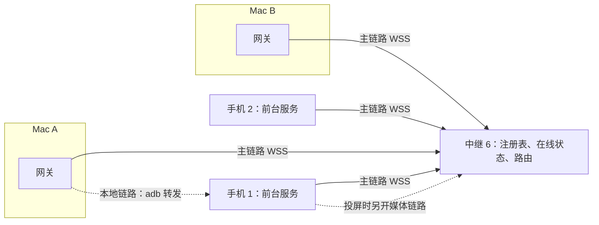
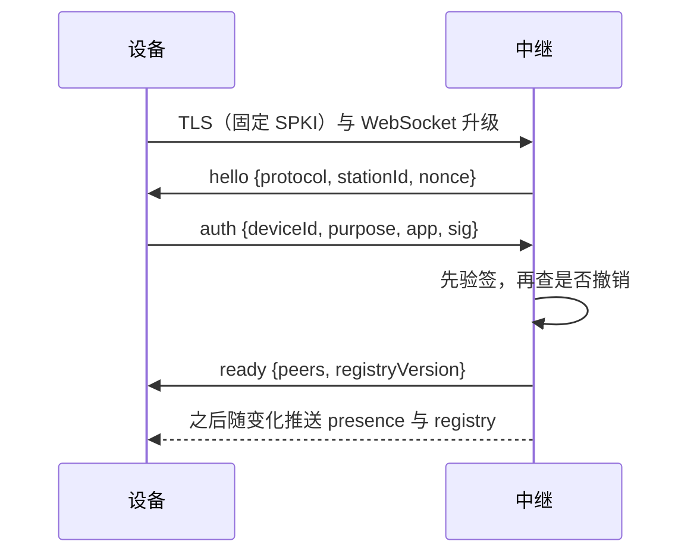
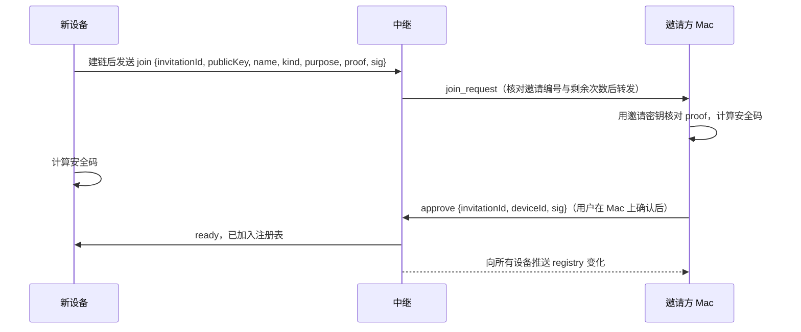

# 设计稿：统一链路与设备身份（Link v2）

状态：设计稿。L0 向量、L1 链路库、L2 回执库和 L3 中继 6 已进入源码。现有 MCP、网关和中继 5 仍按原协议运行；L4 之后仍未实施。当前协议仍以 [中继合约](relay-contract.md)、[远程控制与事件](remote-control.md)、[远程屏幕](remote-screen.md) 和 [MCP](mcp.md) 为准。Link v2 指 Mac 与手机之间统一的传输与身份层，与 Mac App 里表示 adb 连接的 `LinkSession` 无关。

已定前提：不保留旧协议和旧工具名，三端同批升级；多设备只服务同一所有者的多台 Mac 与多台手机；端到端加密可选、默认关闭，默认仍信任自建中继；机型改为能力探测，相应的 AGENTS.md 规则随实施修改。本篇覆盖传输、设备身份、配对与授权、操作回执、事件、端到端加密和中继 6。AI 工具面、Mac 常驻进程整合和手机特权进程合并见[改造路线](roadmap.md)，实施前各自细化。

## 现状的问题

| 现状 | 影响 | 依据 |
| --- | --- | --- |
| 每次远程调用先起钥匙串助手进程、新建固定证书的 TLS，再读一次 status 取会话代号，最后 POST | 每次调用至少两次 HTTPS 往返加一次进程启动 | `lib/remote-gateway/main.go` 的 `remoteCall` |
| 中继只有一个执行位；手机在控制连接的读循环里同步执行；网关再串行一次 | 一次长操作挡住剪贴板、通知和状态查询 | 中继 `device.active`，手机 `PhoneRelayClient.runControl` |
| 身份是两枚静态角色令牌，中继配置只有一个 DeviceID，持久状态绑定三者摘要 | 一台中继只能配一对设备；令牌泄露即可冒充；更换要两端重填 | `server/relay/internal/relay/store.go` |
| 手机只为后台任务（shell、截屏、安装）保存回执；文件修改等其他写操作在本地通道没有回执，远程回执存在中继，两边编号不通用 | adb 断开时，本地发出的文件修改等操作无法核实，只能报告结果未知 | [请求协调与结果恢复](mcp.md#请求协调与结果恢复) |
| 中继把结果正文写入磁盘缓存 | 文件、剪贴板和通知内容可能在中继保留最多 10 分钟 | [会话编号与兼容](relay-contract.md#会话编号与兼容) |
| 文件字节与终端输入用十六进制 JSON | 体积翻倍，单次大小受 JSON 正文上限限制 | `station_file_*_bytes`、`station_terminal_input` |
| 状态靠轮询 | 本地每秒 ping；通知 2 秒、设备健康 3 秒；CLI 每 0.5 秒查一次任务结果 | [哪些请求仍然定时发生](remote-control.md#哪些请求仍然定时发生) |
| 手机本地令牌随进程重启更换，每次经 adb 读取受 DUMP 保护的诊断输出 | 本地通道要靠 adb shell 往返才能恢复 | [监听和令牌](mcp.md#监听和令牌) |

2026-10-16 的[资源与耗电基线](history/validation.md#2026-10-16-资源与耗电基线)显示，手机 20 秒一次的中继心跳耗电可以忽略：16 小时 Wi-Fi 共 4.0 mAh。改造的收益主要来自 Mac 侧轮询、每次调用的连接与进程开销，以及并发和可核实性，不来自降低心跳频率。

## 目标与边界

1. 本地（adb 转发）与远程（中继）使用同一套帧、认证和操作语义；同一操作编号可以在任一通道查询。
2. 设备身份是不可导出的设备密钥，配对不再手抄令牌。
3. 一台中继服务同一所有者的多台 Mac 与多台手机；手机对每台 Mac 分项授权。
4. 操作可以并发和取消；有副作用的操作先在手机落盘回执，结果以手机为准。
5. 状态变化由手机推送，去掉固定轮询。
6. 文件、终端与媒体使用二进制流和流控。
7. 中继只负责认证、在线状态和路由，不保存操作和结果；端到端加密可选。

不做：多用户与共享授权；P2P 直连或 NAT 穿透；局域网监听（手机仍只听回环）；远程替代完整 adb；兼容旧协议。

| 术语 | 含义 |
| --- | --- |
| 工位 | 同一所有者的设备集合，对应一台中继 |
| 链路 | 一条 WebSocket 连接：设备到中继，或 Mac 经 adb 转发到手机 |
| 会话 | 一台 Mac 与一台手机在一条链路上的端到端会话 |
| 操作 | Mac 发起、手机执行的一次调用，带编号；有副作用的带回执 |
| 流 | 会话内的有序字节通道，带流控 |

## 拓扑

Mac 端链路由网关持有，Mac 常驻进程拆分后由该进程持有；App 与 CLI 不直接使用 Link v2。手机端由现有的 MCP 前台服务持有，不新增进程。每台设备对中继保持一条主链路；投屏时另开一条媒体链路，让视频不挤占控制帧，并使用独立的 TCP 拥塞控制。本地投屏、录屏继续使用 scrcpy。

## 设备身份

| 项目 | Mac | 手机 |
| --- | --- | --- |
| 密钥 | ECDSA P-256；优先 Secure Enclave，不可用时为登录钥匙串中的软件密钥 | ECDSA P-256，Android Keystore，不可导出，后台服务签名不需要用户验证 |
| 签名 | DER 编码的 ECDSA-SHA256 | 同左 |
| 公钥编码 | SubjectPublicKeyInfo DER | 同左 |

`deviceId` 取公钥 SPKI DER 的 SHA-256 前 16 字节，JSON 中写成 32 位小写十六进制，界面显示设备名与前 8 位。设备密钥不轮换也不导出；重置身份就是一台新设备，需要重新加入。选 P-256 是因为 Secure Enclave 只支持 P-256，Android Keystore 自 API 23 起支持 P-256 签名，Go 标准库也能直接使用。软件密钥回退时，保护强度等同现在保存在登录钥匙串里的令牌。Mac 另外保存中继地址、指纹和已知设备列表；手机保存同样的资料和自己的授权列表。

中继初始化时生成随机的 `stationId`。所有签名都带用途前缀和 `stationId`，同一签名不能用于另一台中继或另一种用途。

## 链路

### 传输

| 链路 | 地址 | 安全 |
| --- | --- | --- |
| 远程主链路与媒体链路 | `wss://<中继>/v2/link` | 固定 SPKI、校验主机名、不跟随重定向；认证在链路内完成，不放 URL 或请求头 |
| 本地链路 | Mac 经 adb 转发连接手机回环 `ws://127.0.0.1:8765/v2/link` | adb 通道加双向设备签名；拒绝带 Origin 的升级和非回环 Host |

WebSocket 只用二进制消息，一条消息一个帧，不启用压缩。中继和手机沿用现有的来源、重复字段、JSON 深度与 UTF-8 校验。

### 帧格式

帧头 32 字节，大端序：

| 偏移 | 长度 | 字段 | 说明 |
| --- | --- | --- | --- |
| 0 | 1 | version | 固定 2 |
| 1 | 1 | kind | 见下表 |
| 2 | 1 | flags | 0x01 已加密，0x02 流结束，0x04 消息还有后续分片 |
| 3 | 1 | reserved | 0 |
| 4 | 16 | peer | 对端 deviceId。发送方写目的地，中继转发时改写为来源；链路控制帧为全零 |
| 20 | 4 | channel | 0 为会话控制；流由 Mac 发起时用奇数，手机发起时用偶数 |
| 24 | 8 | seq | 每个会话每个方向从 0 递增；链路控制帧为 0 |

| kind | 名称 | 范围 | 内容 |
| --- | --- | --- | --- |
| 0x01 | link | 止于中继，本地链路止于对端 | 链路控制 JSON：hello、auth、ready、presence、registry、ping、error |
| 0x02 | handshake | 端到端 | 会话握手 JSON |
| 0x03 | message | 端到端 | 应用 JSON：操作、结果、订阅、事件 |
| 0x04 | data | 端到端 | 流字节 |
| 0x05 | credit | 端到端 | 4 字节窗口增量 |
| 0x06 | reset | 端到端 | 关闭或拒绝一个流，附 JSON 原因 |

| 限制 | 初值 |
| --- | --- |
| 单帧负载 | 主链路 32 KiB，媒体链路 256 KiB |
| 分片重组后的消息 | 1 MiB；更大的参数或结果走流 |
| 每个会话的流 | 8 个，每个初始窗口 128 KiB |
| 每台 Mac 在一台手机上的在途操作 | 8 个，由手机在握手中声明 |
| 中继每条链路的待发队列 | 主链路 4 MiB，媒体链路 8 MiB；超出说明接收方停滞，断开该链路 |
| 心跳 | 空闲时每 20 秒一次，45 秒没有入站帧即断开 |

编解码还拒绝这些帧：`reserved` 不是 0；`flags` 出现 0x01、0x02、0x04 以外的位；`kind` 不在 0x01 到 0x06；`link` 帧的 peer、channel 或 seq 不是 0；`credit` 的负载不是正好 4 字节；负载超过该链路的单帧上限。负载本身不在这一层解析，加密帧也只先按帧头接受。

发送方按优先级排帧：链路控制，会话控制与小消息，终端流，文件流。在 2 Mbps 上行下，一个 32 KiB 的帧最多让后面的控制帧多等约 0.13 秒。

### 建链与认证

`sig` 签署 `"phone-station link-v2 auth" ‖ stationId ‖ nonce ‖ deviceId ‖ purpose`，`purpose` 为 `main` 或 `media`。这些字段按原始字节直接相连，没有长度前缀，也没有结尾的 0。`stationId` 是 16 字节随机数，nonce 是 32 字节随机数，deviceId 是 16 字节，purpose 是对应的 ASCII。签名是对这段字节做 SHA-256 后的 ECDSA P-256，DER 编码。同一设备新的已认证主链路接替旧链路，旧链路上的会话随之结束，与现在的网络切换语义相同。认证失败时返回 `error {code}` 后断开，`code` 为 `unknown_device`、`revoked` 或 `bad_signature`。先验签：先核对签名，再看是否已撤销，所以撤销设备上的错误签名是 `bad_signature`。`rate_limited` 只用于同一地址上失败的 `enroll` 与 `join`，不用于 `auth`。签名有效的已注册设备不受限流影响，规则见[中继 6](#中继-6)。设备收到 `unknown_device`、`revoked` 或 `bad_signature` 后停止自动重连，提示用户重新加入或检查设备密钥；`enroll` 与 `join` 的 `rate_limited`，以及网络错误，按退避重试。

本地链路由手机担任认证方，双向签名：Mac 先发 `hello`，带自己的 deviceId 与随机数；手机回 `hello`，带自己的 deviceId、随机数和对 Mac 随机数的签名；Mac 再发 `auth`，签署手机的随机数。本地签名的原文是 `phone-station link-v2 local-auth`、对方的 16 字节 deviceId、对方的 32 字节 nonce、自己的 16 字节 deviceId，同样直接相连。算法与中继认证相同。手机只接受自己授权列表里的 Mac，未配对的 Mac 只能发起配对请求。Mac 核对手机公钥与配对时记录的一致，防止别的应用占用回环端口冒充手机。这替代现在的手机本地令牌：Mac 不再经 dumpsys 读取令牌，手机上的其他应用连到回环端口也无法冒充任何一方。

### 会话

链路就绪后，Mac 在 channel 0 上向某台手机发起会话：

| 消息 | 方向 | 内容 |
| --- | --- | --- |
| `open` | Mac → 手机 | 特性列表、限制、是否加密；加密时带临时公钥与签名 |
| `accept` 或 `reject` | 手机 → Mac | 特性与限制，加密时带临时公钥与签名；拒绝原因如 `unknown_peer`、`busy` |
| `welcome` | 手机 → Mac | 会话建立后的第一条消息，加密时已加密：`receiptEpoch`、机型与系统、方法表、本 Mac 的授权 |

方法表列出每个方法的名称、所需授权、是否有副作用、当前是否可用，以及是否已在该机型验证。能力探测通过这张表实现：机型相关的方法在未验证的机型上标为未验证，由用户在手机上按设备开启。

会话绑定在一条链路上。同一台 Mac 可以同时在本地和远程各有一个会话，两者共享手机上的操作回执，所以编号可以跨通道查询。链路断开即会话结束，重新建链后重新握手。

## 操作与回执

### 消息

| type | 方向 | 字段 |
| --- | --- | --- |
| `call` | Mac → 手机 | `op`、`method`、`params`、可选 `stream`、`queueMs` |
| `accepted` | 手机 → Mac | `op`、`state`；有副作用的方法在回执落盘后才发送，只读方法可以直接回 `result` |
| `result` | 手机 → Mac | `op`、`state`、`result` 或 `error` |
| `cancel` | Mac → 手机 | `op` |
| `query` | Mac → 手机 | `ops`，最多 64 个 |
| `status` | 手机 → Mac | 每个 op 的 `state` 与可选 `result` |
| `ack` | Mac → 手机 | 已收到结果的 `ops`；手机可提前丢弃结果正文，回执保留 |

`op` 由 Mac 生成，是 32 位小写十六进制随机数。它同时取代中继 `operationId`、会话代号和手机 `jobId`；MCP 的 JSON-RPC `id` 只留在 Mac 网关与 AI 客户端之间。手机按 `(macId, op)` 保存回执，不同 Mac 的编号互不干扰。

### 状态

| state | 含义 | Mac 能否自动重发 |
| --- | --- | --- |
| `queued` | 已落盘，未开始 | — |
| `running` | 已开始 | 否 |
| `complete` | 完成，结果在 `result` | 否 |
| `failed` | 失败；`applied: false` 表示失败发生在任何副作用之前 | 否，需要时用新编号 |
| `expired`、`canceled` | 排队超时或开始前被取消，确定没有执行 | 否，需要时用新编号 |
| `unknown` | 开始后被进程退出等中断 | 否，报告需要核实 |
| `not_found` | 查询时手机没有这条回执 | 仅限下面的条件 |

`not_found` 只有在两个条件同时满足时才证明手机从未接受：`receiptEpoch` 与提交时相同；距离提交不超过 10 分钟，由 Mac 用自己的单调时钟计时，不依赖两端对时。手机不会淘汰 1 小时内的回执，所以这两个条件足够。此时 Mac 可以用原编号、原参数重发，这是除 `busy` 外唯一允许的自动重发。即使原请求随后晚到，手机也只执行一次：回执插入是原子的，只有插入成功的一方执行。Mac 进程重启后不自动重发，只查询并报告。

### 手机端规则

- 有副作用的方法先写回执并 fsync，再执行。同编号、同参数摘要返回原回执；摘要不同返回 `conflict`。本阶段的库在 `dev.phonestation.adbkeep.link.LinkReceipts`，现有工具仍用 `OperationJobs`，还没有调用它。磁盘上每个回执一行：`v1`、macId、op、方法、参数 SHA-256、状态、applied、开机编号、单调毫秒、结果正文的 Base64；`epoch` 文件保存 `receiptEpoch`。同一次开机用单调时钟算年龄；开机编号变了，只把年龄看成不少于这次开机已过的时间，避免改系统时间把回执提前删掉。只读初表是 `device.status`、`capabilities.get`、`op.query`、`file.stat`、`file.read`、`clipboard.get`、`notifications.list`。`shell`、`install`、`screen` 和 `controls.capture` 走特权队列；其他 `file` 走文件队列；其余有副作用的方法走交互队列。特权队列的 4 个排队名额和三个并发上限按进程计，8 个在途上限按 Mac 计。
- 只读方法不写回执，Mac 可以用新编号重试。方法是否只读以手机的方法表为准，不由 Mac 推断。只读调用同样占这台 Mac 的在途名额，并按方法组进入对应队列，不能绕过并发上限。`query` 与 `cancel` 是会话消息，不是调用，不占名额，在途满了也能查询和取消。
- 回执保存 24 小时。结果正文最多保存 64 KiB；更长的结果照常在这次 `result` 里送达，回执仍记为 `complete`，并标记 `resultKept: false`，之后查询只有状态。超长不是失败：副作用已经发生，改记 `failed` 会让调用方误以为可以重做。收到 `ack` 或满 10 分钟后丢弃正文，由定期整理完成，不等下一次查询；丢弃后查询同样标记 `resultKept: false`。
- 回执最多 4096 条，保存的正文合计不超过 8 MiB，超出时先丢最旧的正文。条数满时只能淘汰已结束且超过 1 小时的回执；仍然满就返回 `busy`。手机在内存里保留回执索引，提交和查询不逐个读盘。回执年龄按开机编号和单调时钟判断，不受手机改时间影响。
- 失败与 `applied`：方法在改动任何东西之前发现的失败，例如授权、功能开关、参数校验、`targetVersion` 不符、特权助手不可用，用「未执行」类错误报告，记为 `failed`、`applied: false`。其他失败一律 `applied: true`。
- 落盘：临时文件写完 fsync，原子改名，再 fsync 所在目录，否则断电后改名本身可能丢失。Android 上用 `android.system.Os.open` 以只读打开目录，再 `Os.fsync`；`FileInputStream`、`RandomAccessFile` 会拒绝打开目录。`queued` 写不进去就返回 `busy`，不执行；`running` 写不进去就把这条记为 `expired`、释放名额，不执行；最终状态写不进去时照常释放名额，本进程内按内存里的结果应答，重启后由磁盘上的 `running` 变成 `unknown`。
- 进程重启后，`queued` 改为 `expired`，`running` 改为 `unknown`。`receiptEpoch` 只在回执库重建时改变，例如清除数据或重装。
- 执行分三个队列，初值：交互类（剪贴板写入、通知、提醒和其他非文件、非特权方法）4 个并发；文件类 2 个并发，写入仍受现有的进程级文件事务锁串行；特权类（shell、安装、截屏和 `controls.capture`）1 个并发，最多 4 个排队，排队超过 10 秒即过期。过期由定时器处理，不等前一个操作结束，查询看到的状态与到期时间一致。超出在途上限时返回 `busy`，表示没有接受。
- 取消：排队中的操作直接改为 `canceled`，不再执行。运行中的取消只在本进程内存里做标记，调用返回后的状态仍以结果为准；shell 结束进程组、上传丢弃临时文件留到接入现有工具时。

### 方法与授权

方法名的形式是 `组.动作`，例如 `file.stat`、`file.read`、`clipboard.get`、`shell.run`、`terminal.open`、`screen.open`。首版的方法与现有工具一一对应，Mac 网关继续对外提供现有 MCP 工具；之后重做 AI 工具面时只改 Mac 端的映射，不改链路。

| 手机授权项 | 方法组 |
| --- | --- |
| 状态（默认开启） | `device`、`capabilities`、`op` |
| 文件读取 | `file` 的读取类 |
| 文件修改 | `file` 的修改类 |
| 剪贴板与通知 | `clipboard`、`notifications` |
| 手机控件与提醒 | `controls`（截屏、亮屏、手电筒、打开文件）、`alert` |
| 投屏与操控 | `screen` |
| Shell 与安装 | `shell`、`terminal`、`install` |

## 流

流用于超过 1 MiB 的参数和结果、文件字节、终端和媒体。流在 `call` 或 `result` 中声明 channel，数据帧在该 channel 上按序发送；`flags` 的 0x02 表示结束，`reset` 表示中止。接收方按消费进度发 `credit`，发送方不得超出窗口。累计授予的可用窗口超过握手里声明的每流缓冲时，按协议错误重置该流。分片按 channel 分别重组，同一 channel 上一条消息的分片之间不能插入别的消息。

- 下载：`file.read` 的结果给出 channel、大小与 SHA-256，随后是原始字节。下载是只读操作，断开后用新编号从需要的偏移重读。
- 上传：`file.write` 在 `call` 中声明流、大小、SHA-256 和 `targetVersion`。手机写入同目录的临时文件，结束后核对大小与摘要，再原子替换。中途断开就丢弃临时文件，结果为 `failed` 且 `applied: false`。
- 终端：每个终端会话一条双向流，输入、输出都是原始字节，取代十六进制输入与轮询读取。断线后 Mac 用 `terminal.attach {session, cursor}` 从原游标续接；终端自己的 60 秒断线租期保留。
- 媒体：投屏的视频、音频与输入走媒体链路，编码参数、输入白名单与时限沿用[远程屏幕](remote-screen.md)。接收端积压超过 5 秒即结束会话，不堆积旧画面。一台手机同时只有一个投屏会话。

## 事件与订阅

Mac 在会话内发送 `subscribe {topics, cursors}`，手机回 `subscribed`，列出实际接受的主题，并说明没有接受的原因。订阅随会话结束。中继推送某台 Mac 离线时，手机立即结束它的订阅，不再需要单独的 20 秒续租；网络黑洞时，以 45 秒心跳期限为界。

| 主题 | 内容 | 语义 |
| --- | --- | --- |
| `device` | 电量、充电、网络、亮屏、调试开关 | 状态型，只发最新值，1 秒内合并 |
| `grants` | 本 Mac 的授权变化 | 状态型 |
| `capabilities` | Shizuku、功能开关、方法可用性 | 状态型 |
| `ops` | 本 Mac 操作的状态变化 | 状态型，按 op 合并；CLI 不再轮询任务结果 |
| `clipboard` | 剪贴板变化 | 有序，带游标 |
| `notifications` | 已选应用的新通知 | 有序，带游标；正文仍只保留 20 秒 |

有序主题至少送达一次，Mac 按游标去重。重连时 Mac 带上最后的游标：手机还持有的部分重新发送，否则发 `reset`，由 Mac 重建基线。不补发历史通知，也不重放旧的剪贴板写入，与现在的规则相同。多台 Mac 各自订阅；它们之间的剪贴板合并规则在剪贴板设计中定义。

## 在线状态与通道选择

- 设备建链或断开时，中继立即向同一工位的其他在线设备推送 `presence`。
- 本地链路靠链路心跳和 adb 设备事件判断存活，不再每秒 ping。
- 两条通道都可用时，新操作优先走本地；在途操作留在原通道。某条通道断开后，在另一条通道上按原编号 `query`。流随通道中断：下载和上传用新编号重来，终端按游标续接。
- 现有的延迟切换阈值保留为策略，延迟取自心跳往返，不另发探测。

## 配对与授权

### 首台 Mac 加入中继

中继 6 的配置只有监听地址、TLS 证书和状态目录，不再有令牌。部署者在服务器上运行 `phone-relay enroll`，生成 128 位的一次性加入码，30 分钟内有效。加入码只在终端显示一次，中继只保存它的摘要，不写日志。首台 Mac 在「连接设置 → 远程接入」填写中继地址、SPKI 指纹和加入码（隐藏输入或 stdin），用设备密钥签名提交 `enroll`，并声明 `purpose`，这条连接随之成为该用途的链路。所有 Mac 都遗失时，用同一命令再生成新码。签名字节和当前代码位置见[中继 6](#中继-6)。发布命令上的 `phone-relay enroll` 留到切换部署；这一阶段由测试进程调用库接口生成加入码。

### 邀请新设备

已加入的 Mac 可以创建邀请：10 分钟有效，只能使用一次，同时最多 4 个。邀请包含中继地址、SPKI 指纹、邀请编号、128 位邀请密钥、邀请方公钥指纹和允许加入的设备类型。中继只保存邀请编号、邀请方、类型、期限和剩余尝试次数（5 次），看不到邀请密钥。

| 传递方式 | 适用 | 校验 |
| --- | --- | --- |
| 本地链路 | 手机已通过 USB 或无线调试连到这台 Mac | adb 通道已由手机授权；邀请直接写入手机，不用扫码 |
| 二维码 | 没有 adb | 手机调用系统相机拍照，在本地解码；应用不申请相机权限。邀请含完整密钥与指纹，自动校验 |
| 手动输入 | 没有相机，或加入另一台 Mac | 输入中继地址和 12 位邀请码，码里含邀请编号和较短的邀请密钥；首次连接时先信任证书，必须比对安全码 |

`proof` 与 `sig` 的字节见[中继 6](#中继-6)。邀请方 Mac 核对 proof，失败时回 `reject`，这次尝试计入剩余 5 次。`sig` 证明新设备持有私钥。安全码取 `SHA-256("ps-sas-v1" ‖ 邀请方公钥 ‖ 新设备公钥 ‖ invitationId ‖ 双方各自看到的中继 SPKI)` 的前 4 字节，按大端无符号整数对 1000000 取模，显示为 6 位数字，不足补 0。两把公钥和中继 SPKI 都是 SubjectPublicKeyInfo DER，invitationId 是 16 字节，中间没有长度前缀。中继替换任何一方的公钥或证书，两端的安全码就会不同。二维码和本地链路的邀请密钥有 128 位，中继无法离线猜出，安全码只用于确认；手动输入的码较短，所以必须比对。

加入中继不等于获得手机访问权。新加入的手机把邀请方 Mac 写入自己的授权列表，前提是用户在手机上点「允许」。新加入的 Mac 第一次向已有手机发起会话时会被拒绝，手机随即显示请求通知，用户在手机上核对安全码后允许。新加入的 Mac 默认只有状态权限，与现在「远程默认只允许查看状态」一致。

### 手机上的授权

手机保存自己的授权列表：每台 Mac 的 deviceId、公钥、名称、加入时间和分项授权。授权项沿用现有六项，改为对每台 Mac 分别设置，例如办公室的 Mac 只开文件，家里的 Mac 另开 Shell。中继注册表决定谁能连接和路由，手机授权列表决定谁能访问这台手机；只在中继注册表里、不在手机列表里的 Mac 打不开会话。授权只能在手机上修改，Mac 只能跳转到对应页面。Mac 端的[客户端令牌](mcp-clients.md)仍是内层限制，外层以手机给这台 Mac 的授权为界。

撤销可以从任意 Mac 或手机发起。发送 `revoke {deviceId}` 后，中继标记撤销、断开该设备的链路，并推送注册表变化。手机收到后删除该 Mac，结束它的会话和订阅，关闭它登记的终端和投屏。手机也可以在本地直接移除某台 Mac。已经执行的操作无法撤回。被撤销的设备只能通过新的邀请重新加入。

### 没有中继时

只用 adb 时，Mac 与手机在本地链路上直接交换公钥：手机弹出确认，两端显示同一个安全码，用户点「允许」即完成配对，不需要中继。之后配置中继时，Mac 经本地链路把邀请交给手机，手机自行加入，Mac 自动批准，不用再次确认。

adb 无线调试本身的配对（菜单栏二维码与手机的「使用二维码配对设备」）不变，与这里的工位配对是两回事。

## 可选端到端加密

每一对 Mac 与手机可以分别设为「必须加密」，默认关闭，设置保存在两端。设为必须加密后，这一对之间的明文会话一律拒绝，不静默降级。本地链路不加密，因为 adb 通道不经过中继。

| 步骤 | 内容 |
| --- | --- |
| 握手 | `open` 带 Mac 的临时 P-256 公钥、随机数和设备签名；`accept` 带手机的临时公钥、随机数和对整个握手记录的设备签名 |
| 密钥 | ECDH 结果经 HKDF-SHA256 派生两个方向各 32 字节的密钥，盐为双方随机数，信息串包含双方 deviceId |
| 加密 | AES-256-GCM；nonce 为 4 字节方向常数加 8 字节 `seq`；附加数据是去掉 `peer` 的帧头，因为中继会改写 `peer` |
| 防重放 | 每个方向的 `seq` 必须递增 |
| 换钥 | 每 24 小时或 2³² 帧重新握手；媒体链路单独握手 |

密钥和帧的字节按下面固定，测试向量据此生成：

| 项目 | 字节 |
| --- | --- |
| 共享秘密 | ECDH 的 32 字节大端 X 坐标，高位的 0 也保留 |
| HKDF | RFC 5869，HMAC-SHA256，输出 32 字节。盐是 Mac 的 32 字节随机数接上手机的 32 字节随机数 |
| Mac→手机 | 信息串 `phone-station link-v2 mac-to-phone`，再接 Mac 与手机的 deviceId。方向常数 `00 00 00 01` |
| 手机→Mac | 信息串 `phone-station link-v2 phone-to-mac`，再接 Mac 与手机的 deviceId。方向常数 `00 00 00 02` |
| nonce | 4 字节方向常数接帧内 seq 的 8 字节大端 |
| 附加数据 | version、kind、flags、reserved、channel、seq，共 16 字节，不含 peer |
| 密文 | AES-256-GCM 的密文接 16 字节标签 |

开启后，中继仍能看到 deviceId、帧类型、channel、大小和时间，看不到正文，但仍可以丢弃或延迟帧。不用 Noise，是因为设备密钥是只能签名的 P-256 硬件密钥，而 Noise 标准只定义了 25519 与 448；签名的临时 ECDH 所需的 ECDH、ECDSA、AES-GCM 和 HMAC 在 Go 标准库、Android 和 CryptoKit 上都有现成实现，HKDF 按 RFC 5869 用 HMAC 实现即可，不需要引入新库。要改为默认开启，需要先固定测试向量并做外部审阅。

## 安全边界

| 威胁 | 默认（信任中继） | 开启端到端加密 |
| --- | --- | --- |
| 网络窃听或中间人 | 固定 SPKI 的 TLS | 同左，另有端到端加密 |
| 手机上的其他应用连接回环端口 | 过不了双向设备签名 | 同左 |
| 设备凭据泄露 | 硬件密钥不可导出；回退到软件密钥时等同现在的钥匙串令牌 | 同左 |
| 中继被攻破 | 能读取正文，能冒充手机授权列表里的 Mac，在其已获授权范围内操作 | 不能读取或伪造会话内容；仍能丢弃、延迟帧，伪造在线状态和注册表推送，但新 Mac 仍须在手机上核对安全码才能获得访问 |
| 中继隐瞒撤销 | 被撤销的 Mac 仍可能连到手机 | 同左；以手机本地移除为准 |
| Mac 丢失 | 从其他设备撤销 | 同左 |

Shell 授权仍等于 Shizuku 的 shell/root 能力，链路层不能把它变成沙箱，这一点与[安全与授权](security.md)相同。

## 中继 6

- 只有 `GET /v2/link` 一个接口，主链路与媒体链路由 `auth` 的 `purpose` 区分。
- 持久状态只有一个 `registry.json`：`stationId`、`registryVersion`、设备、撤销记录、未使用的邀请和加入码摘要。权限 0600，写入时用临时文件、fsync 和原子替换，沿用单实例锁。文件损坏或版本未知时拒绝启动并保留文件，不静默重置。
- 不保存操作、回执或结果正文，只在内存中转发。目标设备离线时返回 `undeliverable`；Mac 可以在对方上线后用原编号重发，由手机按回执去重。
- 每个工位最多 32 台设备；每台设备一条主链路、一条媒体链路；加入码与加入尝试按来源地址与邀请限流，已注册设备的认证不限流。
- 日志只记连接事件、deviceId 前缀和原因，不记负载、密钥、邀请码或加入码。认证失败记原因词，deviceId 还没确定时前缀记为 `-`。
- 控制消息放在 kind 为 0x01 的帧里，一条 WebSocket 二进制消息一帧，不压缩。`GET /v2/link` 之外的路径、查询字符串、非 GET 和非空 Origin 都拒绝。服务端先发 `hello`（`protocol` 为 2、`stationId`、32 字节 `nonce`）。`enroll` 或 `join` 成功后，这条连接就是所声明的 `purpose`，随后发 `ready`。已在注册表里的设备用 `auth` 建链，原文沿用[建链与认证](#建链与认证)里的中继认证。
- 限流：认证先验签。签名有效的已注册设备总能认证；`unknown_device`、`revoked` 和 `bad_signature` 只记日志，不计入失败。被撤销的旧 Mac 可能和其他设备在同一个出口地址后面，它的失败不能把整个家庭网络锁住；签名本身也无法靠多试猜中。计入失败的只有 `enroll` 与 `join`：同一来源地址 10 分钟内失败 8 次后，这个地址的 `enroll` 和 `join` 返回 `rate_limited`，邀请自己的 5 次尝试另计。未认证的连接 10 秒内要发出第一条消息，每个来源地址最多同时 16 条；超过时在 WebSocket 升级前返回 HTTP 503。经反向代理部署时，连接地址是代理自己。可信代理默认关闭。只有配置了名单，并且 TCP 对端在名单里，才读 `X-Forwarded-For`，取最右侧、且不属于可信代理的地址；头缺失或没有可用地址时，仍用连接自己的地址。没配置时所有人共用一个计数，只影响加入。
- 错误码：邀请不匹配、名额已满或证明被邀请方拒绝时返回 `rejected`。注册表写不下去时返回 `unavailable`，这次改动不生效：改动先在副本上做，写盘成功后才替换内存里的注册表，原文件保留。之后改注册表的请求（加入码、加入、批准、撤销）照常重试写入，磁盘恢复后自动恢复。加入请求还没交给邀请方就失败时退回这一次尝试；退回时写盘失败同样返回 `unavailable`，已经扣掉的次数不恢复。认证和转发不写注册表，照常进行。已建立的链路上，目标不在同一 `purpose` 或已经离线时返回 `undeliverable`，连接保持。
- 转发：每条链路一个写协程和有界待发队列，主链路 4 MiB，媒体链路 8 MiB，按编码后的帧字节计算，含 32 字节帧头。发送方的读循环只把帧放进目标队列，不等目标写完；队列满时断开目标链路，发送方收到 `undeliverable`。一台停滞的设备不能拖住发送方发往其他设备的帧。
- 设备名称 1 到 64 个字符、合法 UTF-8，拒绝控制字符和格式字符（Unicode Cc 与 Cf，例如双向控制符和零宽字符），避免批准页上显示被翻转或伪装的名称。
- 文件格式版本是 1。版本不符、JSON 损坏、权限不是 0600，或目录里已有其他状态文件时，拒绝启动并保留原文件。

| 原文 | 字节 |
| --- | --- |
| enroll | `phone-station link-v2 enroll` ‖ stationId(16) ‖ nonce(32) ‖ deviceId(16) ‖ 加入码(16) ‖ purpose 的 ASCII |
| join | `phone-station link-v2 join` ‖ stationId(16) ‖ nonce(32) ‖ deviceId(16) ‖ invitationId(16) ‖ purpose 的 ASCII |
| approve | `phone-station link-v2 approve` ‖ stationId(16) ‖ invitationId(16) ‖ 新 deviceId(16) |
| proof | HMAC-SHA256，密钥是 16 字节邀请密钥。消息是新设备 SPKI ‖ 名称的 UTF-8 ‖ `00` ‖ kind ‖ `00` ‖ purpose。中继只转发，由邀请方核对 |

样本输入是固定的重复字节（station `11`、nonce `22`、device `33`、加入码 `44`、invitation `55`、proof 密钥 `66`、短 SPKI `77`，名称 `n`，kind `phone`，purpose `main`）。SHA-256 与 proof 由 Go `TestTranscriptBytes` 和 Java `LinkVectorTest` 固定：enroll `28b265654ea39c8988ce7515423255e3295b4e86ebff878c48473487de36002f`，join `e47093674462494c7f377d111faf45bd8a25e6b7be7dda25d84402d6812fced3`，approve `26e8fd0aaf218a1e8063941858db263430729067dd2ddfd727176484f0ce1e97`，proof `fbe5926156331eed23633774e48e7b2b213f4618762151325811bbca517cb5d3`。

本阶段的服务器在 `server/relay/internal/v6`，由测试进程在临时目录上监听真实 TLS。`cmd/phone-relay` 不引用它，`scripts/build-relay.sh` 打出的仍是中继 5。隔离实例留到切换前。

## 失败与恢复

| 情形 | 行为 |
| --- | --- |
| 提交后断开，没有收到 `accepted` | 在任一可用通道 `query`；`not_found` 满足条件时用原编号重发，其他状态按状态处理 |
| 收到 `accepted` 后断开 | `query`；还在运行就等 `ops` 事件；`unknown` 报告需要核实，不重做 |
| 手机进程重启 | `queued` 变为 `expired`，`running` 变为 `unknown`，`receiptEpoch` 不变 |
| 手机清除数据或重装 | `receiptEpoch` 改变，旧编号一律视为未知；设备密钥丢失，需要重新加入 |
| 中继重启 | 链路全部断开，但没有操作状态丢失；重连后 Mac 查询在途编号 |
| 本地与远程切换 | 新操作走可用通道；在途操作按编号查询；流按上文规则处理 |
| 注册表写入失败 | 这次加入、批准或撤销返回 `unavailable` 且不生效；已注册设备照常认证和转发；保留原文件，之后的改动照常重试写入 |

## 资源预期

下表是按设计推算的预期，实施后按[基线](history/validation.md#2026-10-16-资源与耗电基线)的同样方法实测。

| 项目 | 现在 | Link v2 |
| --- | --- | --- |
| Mac 每次远程调用 | 一个钥匙串助手进程、一次新 TLS、两次 HTTPS 往返 | 复用常驻链路，一个帧 |
| 远程在线确认 | 每 2 秒读 status，每分钟一次 MCP ping | 中继推送，20 秒心跳 |
| 本地健康检查 | 每秒 ping | 链路心跳与 adb 设备事件 |
| 通知、剪贴板、设备健康、任务结果 | 0.5–30 秒的轮询或补查 | 事件推送 |
| 中继磁盘 | 最多 4096 条回执与 32 MiB 结果正文 | 只有注册表，KB 级 |
| 文件字节 | 十六进制 JSON，体积翻倍 | 原始字节流 |
| 手机进程 | 前台服务持有本地 HTTP 与中继 WSS | 不新增，同一前台服务持有链路 |

## 实施步骤

去掉轮询与多余特权进程的整改（[改造路线](roadmap.md)的 P1）不依赖本设计：L0–L3 可以与它并行，L4 切换网关之前须完成 P1。

| 步骤 | 内容 | 本机验收 | 真机验收 |
| --- | --- | --- | --- |
| L0 规格与向量 | 帧编解码、认证签名、安全码和加密的测试向量放在仓库，Go 与 Java 共用。向量已在 `lib/link/testdata/vectors.json`。加入、邀请和批准的原文由两种语言的测试锁定同一组摘要。中继 6 的测试服务器使用帧和这些原文；网关、中继 5 和手机服务仍不使用 | 两种实现读同一组向量 | — |
| L1 链路库 | Go 实现供网关和中继共用，Java 实现供手机使用。库已在 `lib/link` 与 `dev.phonestation.adbkeep.link`，目前是帧编解码、重组、窗口、优先级队列和心跳判断这几块原语。中继 6 的测试服务器调用帧编解码；网关、中继 5 和手机服务仍不调用分片、窗口和优先级。L4 之前还要补一层链路引擎（L1b）：连接读写循环、流的打开、结束与重置、按 channel 分别重组、按消费进度发 `credit`、窗口上限、写调度与背压，两种语言跑同一组用例 | 分片、流控、优先级、心跳、超限和畸形帧拒绝；L1b 另加乱序、交错分片、超窗、重置和慢接收方 | — |
| L2 手机回执 | 回执库、`receiptEpoch` 和三个执行队列已在 `LinkReceipts`。现有工具仍走 `OperationJobs`。接入前按[手机端规则](#手机端规则)补齐：超长结果记 `complete`、`applied: false` 的路径、目录 fsync、写失败时的状态与名额、4096 条上限与内存索引、只读调用计入在途、定时过期 | 写前落盘、重启转换、冲突、同编号并发插入；补齐项各有一条用例 | 强杀与重启后查询 |
| L3 中继 6 | 路由、注册表、加入码、邀请和在线推送已在 `server/relay/internal/v6`。真实 TLS 测试随 `server/relay` 的 `go test` 进入 `scripts/check.sh`。发布命令仍是中继 5。审阅项已补进源码：认证先验签且不计数，每条链路一个写协程和有界待发队列，写盘失败只拒绝这一次改动，名称拒绝 Cf。未接入现有通道，隔离实例未启动 | 真实 TLS 联合测试接入 `scripts/check.sh`；同地址撤销设备不影响其他设备、慢接收方不阻塞发送方、写盘失败后已注册设备仍能认证 | 隔离实例 |
| L4 网关切换 | 本地与远程都走 Link v2；跨通道查询；事件替代轮询 | 断线、切换、晚到的重复提交 | Wi-Fi 与蜂窝切换、后台保活、对照基线测耗电 |
| L5 配对界面 | 两端的加入、邀请、授权列表和撤销页面，遵守 [DESIGN.md 开发约束](../DESIGN.md#开发约束) | [界面改动验收](validation.md#界面改动验收) | 拍照导入、adb 配对、手动输入 |
| L6 端到端加密 | 握手、加密、拒绝降级 | 向量、篡改、重放、换钥 | 投屏延迟与 CPU |

实施时同步更新[架构](architecture.md)、[MCP](mcp.md)、[安全与授权](security.md)和[远程屏幕](remote-screen.md)；[中继合约](relay-contract.md)与[远程控制与事件](remote-control.md)被本设计替代后转入历史。AGENTS.md 与 CLAUDE.md 里关于角色令牌、手机本地令牌、MCP 端口和机型限制的规则也要改写，用 agent-docs-sync 同步。

## 切换与回滚

不做双协议并行。切换时需要本机 adb 能连上手机（USB 或无线），因为新版手机端无法向旧中继报告安装完成，配对也要重新进行。

1. 三端构建，本机检查和隔离中继实例全部通过。这是唯一的放行关口。
2. 确认没有在途的中继操作、手机后台任务、终端或投屏。
3. 停止中继 5，完整归档它的状态目录，不删除；部署中继 6，使用新的状态目录，并生成加入码。
4. 经 adb 保留数据安装新版手机端，再安装新版 Mac 端。
5. Mac 加入中继，经本地链路与手机配对，在手机上授予需要的权限。
6. 断开 adb，核对远程链路、操作查询和事件；之后再清除旧的角色令牌条目。

回滚：第 4 步之前，只需恢复中继 5 的程序和归档状态。第 4 步之后，Android 不卸载就无法降级，回滚只能用更高的版本号重新发布旧代码，按一次新发布处理。中继 5 的归档保留旧编号的最终回执，遵守「持久版接收过操作后，不能删除回执」的规则。实际主机和部署回执留在个人运维仓库。

## 实施前要核实

1. 临时签名的 Mac App 与钥匙串助手能否创建并使用 Secure Enclave 密钥；不能时改用登录钥匙串中的软件密钥。
2. PGT-AN20 上 Keystore P-256 签名的耗时，以及是否有 StrongBox。
3. 荣耀系统相机经 `ACTION_IMAGE_CAPTURE` 返回的图片能否稳定解出二维码，以及二维码库增加多少 APK 体积。
4. 手机上 Java-WebSocket 服务端模式的线程与内存，与现有 `McpHttp` 对比。
5. 个人部署的反向代理能否透传 `/v2/link` 的 WebSocket 升级和 256 KiB 的二进制帧，以及中继看到的来源地址是不是代理自己。是的话，加入限流要配置可信代理，否则所有人共用一个计数。
6. adb 能否把本地转发绑定到权限 0600 的 Unix 套接字（`localfilesystem:`），避免其他本机用户连接转发端口。
