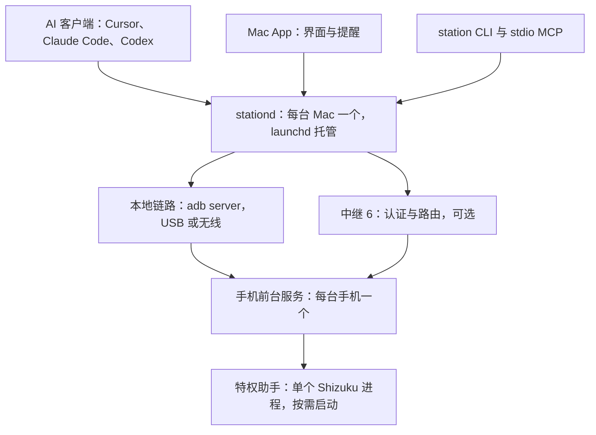

# 设计稿：架构改造路线

状态：实施中。P0 的内置计数器已进入源码，尚未部署，也还没有用它采样；其余阶段仍是设计。现状部分依据 Android 69、Mac 0.1.0 (33)、中继 5 的源码，以及 2026-10-16 的[资源与耗电基线](history/validation.md#2026-10-16-资源与耗电基线)；当前行为仍以[架构](architecture.md)和各主文档为准。Mac 与手机之间的链路、设备身份、配对与授权在[统一链路与设备身份](link-v2.md)里详细设计，本篇只说明它在整体中的位置。某个阶段完成后，在[阶段](#阶段)表里更新状态，三端完成情况按[发布记录](releases.md)记录。

## 结论

1. **底子扎实。** 文件操作带版本号与原子写，远程操作有持久编号和回执，令牌不落明文，中继证书按 SPKI 固定，手机按授权项控制远程访问。这些保留，改造在其上进行。
2. **Mac 端的浪费在空闲轮询。** 本机 adb 没有连接手机时，App 仍每秒起一次 adb、每 5 秒运行一次 `mcp.sh status`，空闲约占 3% CPU。本地连接时，手机每秒执行 14 次 `settings get`、每 2 秒写一次系统设置，Mac 每分钟向手机发约 185 次请求（按代码推算）。改成推送后基本归零。
3. **手机端的浪费在特权进程和前台界面，不在后台服务。** 每个 Shizuku 助手进程约 60 MB PSS，采样时常驻 2 个（手电、剪贴板），每条 shell 命令再临时起 1 个；手电助手是被只读的状态查询拉起的。主进程只跑后台服务时平均 37 MB RSS，主页在前台时平均 172 MB、峰值 359 MB。耗电很低：16 小时约 35 mAh，占 0.75%。
4. **「一台 Mac 对一台手机」写死在四层。** 中继、网关、手机端的通知与剪贴板状态、本机脚本都只认一个对端。多设备要先换成按设备的身份和授权，再逐层放开。
5. **MCP 的主要问题是面向谁。** 51 个工具里混着 App 自己的同步和心跳接口，结果是文本里的 JSON，截图要三步才能让模型看到。MCP 2026-07-28 版规范取消了会话和 `initialize`，工位本来就不依赖会话，升级成本低。

## 已定前提

- 软件尚未正式发布，不保留旧协议和旧工具名，三端同批升级。
- 多设备只服务同一所有者的多台 Mac 与多台手机，不做多用户账户。
- 端到端加密可选，默认关闭，默认仍信任自建中继。
- 机型改为能力探测：通用功能直接可用，依赖机型的功能标为未验证，由用户在手机上按设备开启；实施时修改 AGENTS.md / CLAUDE.md 的机型规则。

## 现状：Mac 空闲时一直在做的事

以手机经 adb 在线、本地 MCP 开启、远程已配置为准。前四行和「网关远程调用」是首要改造对象。

| 来源 | 间隔 | 每次做什么 | 成本 | 改为 |
| --- | --- | --- | --- | --- |
| `LinkSession` 巡检 | 1 秒 | `adb devices -l`；手机在线时再经 `adb shell` 执行 14 次 `settings get` | Mac 每次起 2 个进程；手机每秒至少 15 个进程 | 设备增减用 App 已有的 track-devices 订阅；开关与状态由手机推送 |
| `host-state.sh mark` 心跳 | 2 秒 | zsh、adb 加 `settings put` 写时间戳 | 连接期间每天约 4.3 万次系统设置写入，并触发手机端观察者 | 心跳只记在手机内存 |
| `McpSession` 调 `mcp.sh status` | 5 秒，没有设备也运行 | zsh、python3、adb 和网关子命令；含经 `dumpsys` 读手机令牌 | Mac 每分钟几十到上百个进程 | 只在序列号变化或网关返回 401 时刷新 |
| 剪贴板会话 | 0.8 秒（本地） | `station_clipboard_exchange`；共享关闭时改为状态查询，频率不变 | 每分钟约 75 次请求；共享时手机经 Shizuku 读剪贴板 | 复用远程已在用的剪贴板变化监听（`ClipboardUserService.WATCH`），本地也只在变化时传输 |
| 通知会话 | 2 秒（本地） | `station_notification_poll` 或 `station_notification_status` | 每分钟 30 次请求 | 有新通知时推送（远程已有事件订阅，本地补上） |
| 设备健康 | 3 秒（远程 15 秒） | `station_device_status` | 每分钟 20 次请求 | 随状态推送 |
| 网关本地探测 | 1 秒 | 每次新建 `http.Client`；手机回 `Connection: close` | 每分钟 60 条经 adb 转发的新连接 | 常驻本地链路，靠链路心跳与 adb 设备事件判断存活 |
| 网关远程调用 | 每次调用；状态每 2 秒 | 每次起钥匙串助手读令牌、新建固定证书的 TLS，提交前先读一次状态 | 每次多 1 个进程、1 次握手、1 次往返 | 令牌与会话代号缓存在内存并复用连接，之后改走常驻链路 |
| 网关 `monitor` | 1 秒 | 重读并解析配置文件 | Mac 磁盘读取 | 按修改时间重读 |
| 手机各页面 | 1–2 秒（仅前台） | 整页重绘 | 主页前台亮屏时主进程约占 2.5% 单核（实测，含远程空闲流量） | 状态变化时重绘 |

间隔和「每次做什么」来自源码；Mac 起 adb 与 `mcp.sh` 的频率经本机采样核对；请求数和手机进程数按代码推算，是相关会话都在运行时的数值。手机侧进程、内存与耗电的实测见[基线](history/validation.md#2026-10-16-资源与耗电基线)。

## 现状：结构性问题

### 资源与效率

| 问题 | 依据 | 影响 |
| --- | --- | --- |
| 特权进程按功能叠加 | 剪贴板、终端、投屏、手电、shell 各一个 Shizuku UserService，实测每个约 60 MB PSS | 采样时常驻 2 个，每条 shell 命令再起 1 个 |
| 只读查询拉起特权进程 | `station_controls_status` 调 `ShizukuTorch.status`，绑定手电助手后不退出 | 一次状态查询多出约 60 MB 常驻内存 |
| shell 每条命令起新进程 | `ShizukuShell` 每次绑定、执行后移除 | 每条命令多一次 JVM 启动和约 60 MB 瞬时内存 |
| 两套状态来源 | Mac 一边经 adb 读 `phonestation_*` 系统设置，一边调 `station_controls_status`（已含功能开关），再在 `Station.phoneFeatures` 合并 | 重复轮询；两边不一致时还要调和 |
| 系统设置当通信通道 | 功能开关、MCP 监听和电脑心跳都写在 Settings.Global（`StationFeatures.publish`、`publishListening`、`host-state.sh`） | 写放大；其他应用也能读到工位状态和电脑是否连着 |
| 远程调用不复用连接 | `remoteCall` 每次读钥匙串、新建 Transport 并在结束时关闭，提交前先查一次状态 | 每次多一个进程、一次 TLS 握手和一次往返 |
| 三处串行 | 网关 `remoteGate`、中继 `device.active`、手机在控制连接的读循环里同步执行 | 传大文件时剪贴板和通知都要排队 |
| 二进制走十六进制 JSON | `remote_ops.py` 每 512 KiB 做一次 `chunk.hex()`，手机再解析一次 | 流量约翻倍；大块数据在手机堆上多次复制 |
| SwiftUI 全树失效 | `Station` 转发 15 个子会话的 `objectWillChange` | 任一计时器触发都让面板整体重算 |
| 安装包体积（次要） | APK 5.3 MB；两个 Go 程序解压后 7.5 MB 与 3.2 MB；dex 0.69 MB，未经 R8 | 下载与更新偏大 |

### 多设备

| 问题 | 依据 | 影响 |
| --- | --- | --- |
| 中继只服务一台手机 | 配置只有 `DeviceID`、`PhoneToken`、`DesktopToken`，默认 ID `pgt-an20`；`screenHub.current` 只有一个投屏会话 | 第二台手机或第二台 Mac 只能再部署一套中继 |
| 网关只有一份配置 | 只有一组 `RemoteURL`、`RemotePin`；本地固定 18766 转发 | 不能同时连两台手机 |
| 手机只认一台电脑 | `NotificationSyncState.client`、`ClipboardState.client` | 两台 Mac 会互抢通知游标和剪贴板版本 |
| 本机只接受一台在线手机 | `online_serial` 已按 `ro.serialno` 合并同一台手机的 USB 与无线连接，但发现两台不同的手机就失败 | 两台手机同时连着时脚本无法使用 |
| 远程权限不分电脑 | 手机按授权项控制远程（Android 64 起） | 不能给不同 Mac 不同权限，也不能单独撤销一台 |
| 机型写死 | Mac 端 `remote_ops.py`、`remote_terminal.py` 与手机端 `StationBridge`、`StayAwakeController` 都按 PGT-AN20 判断 | 第二台手机如果是其他型号，设备操作全部不可用 |

### MCP 接口

| 问题 | 依据 | 影响 |
| --- | --- | --- |
| 工具多且混着内部接口 | 51 个工具（文件类 20 个）；剪贴板交换、通知接收、投屏会话等 App 内部接口也在 `tools/list`；描述是较长的中文 | 模型更容易选错，工具描述占上下文 |
| 结果不结构化 | `toolOk` 把 JSON 序列化成一段文字 | 客户端无法按 schema 校验或直接展示 |
| 截图对模型不可见 | `station_screen_capture` 返回临时 PNG 路径，要再用文件工具下载、再调用 release | 看一张图要三步 |
| 协议版本停在 2025-03-26 | 2026-07-28 版是无状态的，有 `server/discover`、任务扩展和可缓存的列表 | 这些能力都用不上 |
| 作用域粒度粗 | [客户端令牌](mcp-clients.md)只分 status、files.read、files.write、shell | 不能单独授权剪贴板、截屏、安装 |
| 电脑与手机之间传文件不在 MCP 里 | 靠 `remote_ops.py` 分块上传 | AI 不能一步完成「把这个文件放到手机上」 |

### 安全与易用

| 问题 | 依据 | 影响 |
| --- | --- | --- |
| 中继能看到内容 | 没有端到端加密，[安全与授权](security.md)已说明 | 已定：做成可选，默认关闭 |
| 配对要手填 4 项 | HTTPS 地址、SPKI 指纹、两枚 64 位十六进制令牌（`RemoteRelayProfile`） | 门槛高、易填错 |
| 运行时依赖多 | zsh、python3、adb；本地投屏要 scrcpy；终端配对二维码要 node | 换一台 Mac 上手慢 |
| 管理界面挤在菜单栏面板 | 中继、客户端、权限和功能都在 360 pt 宽的弹出面板里 | 专业设置难找，也难承载多设备 |
| 守护进程自己拉起 | 网关用 `Setsid` 在后台运行，不受 launchd 管理 | 崩溃恢复、登录启动与升级替换各走各的 |

## 目标架构

每端只留一个常驻进程负责连接与状态，手机再加至多一个按需启动的特权助手；本地和远程用同一套链路协议，状态改为推送。

**Mac（每台）**

- stationd 由 launchd 托管，持有全部手机链路、MCP 服务、在途操作、通知与剪贴板中枢。
- 直接使用 adb server 协议（App 订阅设备变化已经这样做），不再起 adb、zsh、python3 子进程。
- App 只做界面：经本机套接字订阅一条状态流；管理类页面移到设置窗口。
- `station` CLI 与 stdio MCP 入口复用同一份 Go 代码，`scripts/` 保留为入口。

**中继（可选）**：同一所有者的设备注册表、邀请与在线状态推送；只做认证和路由，不保存操作与结果；每台手机一个投屏会话；开启端到端加密后只转发密文。见[中继 6](link-v2.md#中继-6)。

**手机（每台）**

- 一个前台服务承载链路、调度、回执与状态；状态变化主动推送，不再用系统设置当通信通道。
- 一个特权助手合并剪贴板、手电、shell、终端与投屏启动；状态查询不绑定它；剪贴板共享关闭且没有会话时退出。
- 按「Mac × 授权项」授权；每台 Mac 各自订阅通知和剪贴板。

链路层的控制消息用 JSON，数据用二进制流；多个操作可以并发；心跳、能力协商和操作编号都在链路层；投屏走同一帧格式的独立媒体链路。细节见[统一链路与设备身份](link-v2.md)。

## 多手机与多 Mac

范围是同一所有者，不做多用户账户。

| 层 | 现在 | 改为 |
| --- | --- | --- |
| 身份 | 两枚共享的角色令牌，手工生成和填写 | 每台设备一把不可导出的设备密钥，deviceId 由公钥派生，见[设备身份](link-v2.md#设备身份) |
| 配对 | 手填中继地址、SPKI 指纹、手机令牌、电脑令牌 | 第一台 Mac 用加入码加入中继；之后由已加入的 Mac 发邀请，经本地 adb、拍照导入二维码或手输邀请码加入，手输时核对安全码，见[配对与授权](link-v2.md#配对与授权) |
| 中继 | 1 个设备 ID、1 对令牌、全局 1 个在途操作、1 个投屏会话 | 一个工位最多 32 台设备；只认证和路由；在途上限由手机声明；每台手机 1 个投屏会话 |
| 授权 | 手机按授权项控制远程，不区分电脑 | 手机按「Mac × 授权项」授权，可单独撤销一台；本地连接同样经过这张表 |
| 通知 | 手机只记 1 个接收方游标 | 每台 Mac 各自订阅、各自游标；提醒可选只发给当前在用的 Mac |
| 剪贴板 | 手机只记 1 个 client | 以手机为准的版本号并记录来源设备，避免两台 Mac 之间回环；合并规则在 P5 单独设计 |
| Mac 网关 | 1 份远程配置，固定 18766 转发 | 每台手机一条链路；本地转发按序列号分配；MCP 用 `device` 参数或 `/mcp/d/<id>` 路由 |
| 本机 adb | 只接受 1 台在线手机 | 多台手机并存，按设备分别建链；同一台的 USB 与无线连接仍按 `ro.serialno` 合并 |
| 机型 | 只在 PGT-AN20 开放设备操作 | 按能力探测；通用功能直接可用，依赖机型的功能（无线调试保持、手电、灯光跟随声音等）标为未验证，在手机上逐台开启 |
| 加密 | 中继可读内容 | 可选端到端加密，默认关闭，见[可选端到端加密](link-v2.md#可选端到端加密) |
| 界面 | 单设备视图 | 菜单栏显示当前手机并可切换；手机首页列出已授权的 Mac 和各自权限 |

## MCP v2

### 原则

1. stationd 是唯一的 MCP 服务端：AI 工具目录、作用域、设备路由都在 Mac 侧；手机只提供链路的[方法表](link-v2.md#方法与授权)，能力实现仍在手机应用服务里。
2. App 不再走 MCP：剪贴板同步、通知接收和投屏会话改用链路的方法与事件，`tools/list` 只留给 AI 用的工具。
3. 协议版本按客户端协商：兼容客户端在用的版本，同时实现 2026-07-28 版的 `server/discover`、请求自带协议版本和 `subscriptions/listen`；`tools/list` 带 `ttlMs` 并固定顺序。
4. 结构化输出：`outputSchema` 加 `structuredContent`，另附一段文字摘要；截图直接返回图片内容；大结果返回资源链接。
5. 长任务（安装、大文件、后台 shell）映射到任务扩展 `io.modelcontextprotocol/tasks`；任务编号就是链路的操作编号，状态以手机回执为准。
6. 作用域覆盖全部能力：在 status、files.read、files.write、shell 之外加 clipboard、capture、install、alert、control，并可限定到某台手机；外层仍以手机给这台 Mac 的授权为界。
7. 接入不用复制令牌：`station mcp` 作为 stdio 入口从钥匙串取凭据；App 一键写入 Cursor、Claude Code、Codex 的配置，并显示每个客户端最近的调用。
8. 工具名去掉 `station_` 前缀（客户端已按服务名分组），不保留旧名称；描述改为简短英文，界面仍用中文；改造前后各测一次 `tools/list` 的 token 数。

### 工具集

现有 51 个工具中，35 个合并为下表 18 个，16 个移出 `tools/list`。

| 工具 | 取代（省略 `station_` 前缀） | 说明 |
| --- | --- | --- |
| `device_list` | 新增 | 已配对的手机、在线状态、所走通道、机型与已验证能力 |
| `device_status` | `device_status`、`controls_status`、`storage_summary`、`file_access_policy` | 一次拿到电量、亮屏、功能开关、授权与阻塞项；不拉起任何助手进程 |
| `files_list` | `file_list`、`file_search` | 列目录或按名称搜索 |
| `files_stat` | `file_stat` | 返回 `targetVersion` |
| `files_read` | `file_read_text`、`file_read_bytes` | 文本或 base64，支持区间 |
| `files_write` | `file_write_text`、`file_write_bytes`、`file_append_text`、`file_append_bytes`、`file_truncate_bytes` | 覆盖已有文件必须带 `targetVersion` |
| `files_edit` | `file_replace_text`、`file_patch_bytes` | 精确替换或按偏移修补 |
| `files_manage` | `file_copy`、`file_move`、`file_delete`、`file_delete_directory`、`file_create_directory` | 用 `action` 区分；删除仍需版本 |
| `files_grep` | `file_search_text` | 按内容搜索 |
| `files_transfer` | 新增，由 stationd 执行 | Mac 路径与手机路径之间流式传输并校验 SHA-256；下载中断后按偏移续读，上传中断后整份重传 |
| `app_install` | 新增，取代脚本流程 | 从 Mac 路径安装 APK，作为长任务 |
| `screenshot` | `screen_capture`、`screen_capture_status`、`screen_capture_release` | 直接返回图片内容，自动释放临时文件 |
| `shell_run` | `shell_exec`、`shell_start`、`shell_status` | 短命令同步返回，长命令转为任务 |
| `clipboard_read`、`clipboard_write` | `clipboard_get`、`clipboard_set` | 显式读写；交换只留给 App |
| `phone_alert` | `notify` | 响铃、震动、横幅 |
| `device_control` | `stay_awake`、`torch`、`file_open` | 用 `action` 区分，各需对应授权 |
| `task_status` | `operation_status` | 按原编号查询；同时映射到 MCP 任务扩展 |

移出 `tools/list`、改为 App 经链路使用的接口：`clipboard_exchange`、`clipboard_configure`、`clipboard_state`，`notification_poll`、`notification_status`、`notification_configure`、`notification_icon`，`screen_open`、`screen_close`、`screen_status`、`screen_capture_start`，以及 `terminal_open`、`terminal_close`、`terminal_input`、`terminal_read`、`terminal_resize`。

## 阶段

不保留旧协议，每个阶段三端同批升级，按源码、测试、构建、设备部署、服务恢复分开报告。顺序：先做 P1；P2 的 L0–L3 可以与 P1 并行，L4 切换网关之前完成 P1；P3 可与 P2 后半段并行；P4 在 P2、P3 之后；P5 依赖 P2 到 P4；P6 的端到端加密在 P2 之后，其余可与 P3 到 P5 并行。

| 阶段 | 内容 | 规模 | 状态 |
| --- | --- | --- | --- |
| P0 | 基线与可观测 | S | 计数器已进源码；在线基线与峰值来源仍待手机 |
| P1 | 快速降耗 | M | 未开始 |
| P2 | Link v2 与单一特权助手 | L | 链路已有设计稿；特权助手待设计 |
| P3 | Mac 端整合为 stationd | L | 未开始 |
| P4 | MCP v2 | M | 未开始 |
| P5 | 多手机与多 Mac | L | 未开始 |
| P6 | 安全与专业化 | M–L | 未开始 |

### P0 基线与可观测

- 已完成：手机侧进程、内存、耗电与 CPU 的远程只读采样，以及本机 adb 没有连接手机时的 Mac 采样，见[基线](history/validation.md#2026-10-16-资源与耗电基线)。
- 已进入源码、尚未部署：内置计数器。手机「连接设置 → 运行计数」显示本次进程内的请求分类、成功的系统设置写入、五个助手的绑定与解除、中继重连。`mcp.sh status --safe` 的 `usage.gateway` 是网关进程内的调用、钥匙串助手启动和链路恢复；`usage.app` 是菜单栏 App 本次进程的 adb、脚本和其他进程启动，以及每次启动 `connect.sh`。读计数不访问手机，数字也不进入状态推送。进程重启后内存计数清零；App 退出后文件里留下最后一次快照，看 `updatedAt`。
- 待手机在场：Mac 在「仅 adb」「adb 与远程都在」两种状态下的起进程数与请求数；手机主进程 359 MB 峰值的来源。这两项要在计数器部署到手机和正在使用的 Mac App 之后，按基线的同样方法采样，再写入 `docs/history/`。运行计数的大字号、窄屏、中英和折叠重建也还没在真机上点过；行布局复用连接检查，文案和数字格式有本机回归。

验收：补充的基线写入 `docs/history/`，作为之后每个阶段的对比口径。风险：只读采样，需要手机在线。源码里的计数器不能代替这次采样。

### P1 快速降耗

- 手机：状态查询不再绑定手电助手，没开灯时直接报告未开；shell 命令改在常驻助手里执行，不再每条命令起进程；页面只在状态变化时重绘。
- Mac App：去掉每秒的 `adb devices -l` 和 14 次 `settings get`，设备变化用已有的 track-devices 订阅，开关状态用 `station_controls_status` 已返回的功能开关；`mcp.sh status` 只在序列号变化或网关返回 401 时运行；本地剪贴板与通知改为挂起等待变化的请求，利用手机已有的变化监听；`Station` 改为按页面订阅子会话。
- 网关：配置按修改时间缓存；远程令牌按 revision 缓存在内存；复用一条固定证书的连接；本地探测复用 client。
- 心跳：把网关已认证的请求当作心跳，只记在手机内存，`host-state.sh` 不再写系统设置。

验收：`scripts/check.sh` 全量、`lib/android/build.sh`、`scripts/build-mac-app.sh`；按 P0 口径复测，手机常驻助手从 2 个降到最多 1 个，Mac 空闲起进程数与设置写入数接近零，手机复制后 Mac 出现内容的延迟不劣于现在。

风险：三端同批升级，不保留旧心跳与旧轮询。网关连接复用和本地挂起请求会在 P2 被链路取代，只做最小改动。

### P2 Link v2 与单一特权助手

- 按[统一链路与设备身份](link-v2.md#实施步骤)的 L0–L5 实施：统一帧格式、并发操作与手机回执、事件推送、设备密钥与配对、按 Mac 分项授权、中继 6。本地也走链路，不再用本地 HTTP 和手机临时令牌。首版方法与现有工具一一对应，MCP 工具面留到 P4。
- 合并 5 个 Shizuku UserService 为一个特权助手：按角色分发 binder 调用，需要时启动，剪贴板共享关闭且没有会话时退出。实施前单独细化设计。
- 文件、APK 与截图走二进制流，手机侧用固定大小的缓冲。

验收：链路设计各步骤的本机与真机验收；链路合约测试接入 `scripts/check.sh` 的真实 TLS 联合合约；配对全程不出现明文令牌。本地与远程各做一次 APK 安装和大文件往返；手电持灯、终端会话和投屏在单一助手下各验证一次（设备操作要有对应授权）。

风险：直接替换 control-v1 与本地 HTTP，不保留双栈。按[切换与回滚](link-v2.md#切换与回滚)执行；公网切换前按 AGENTS.md 准备版本、影响、验证与回滚条件，并先排空在途操作。

### P3 Mac 端整合为 stationd

- 网关升级为 stationd：用 SMAppService 注册 LaunchAgent，取代 `Setsid` 自启动；直接使用 adb server 协议（track、forward、shell v2）；mDNS 发现移入 Go。
- App 与 stationd 之间用本机 Unix 套接字，校验对端 UID 与代码签名；一条状态流加命令；去掉状态 watch 子进程。
- `station` CLI 承接 `scripts/` 的实现，`scripts/*.sh` 保留为入口；运行时不再依赖 python3 与 node，开发和测试照用。
- 本地投屏与录屏改走远程投屏已有的原生解码管线，scrcpy 变为可选。

验收：`scripts/check.sh`；用假 adb server 的 stationd 集成测试；Mac 包构建；登录启动、崩溃自启、升级替换；按 P0 口径复测。

风险：迁移时要清理旧守护进程残留与端口占用。AGENTS.md / CLAUDE.md 里关于 `lib/adb_mdns.py`、`online_serial` 和脚本写法的规则随之改写，经 agent-docs-sync 同步。

### P4 MCP v2

- 按上文[MCP v2](#mcp-v2)的原则与工具集实施；App 内部接口全部移出 `tools/list`；同步更新 phone-mcp Skill、脚本、文档，以及 AGENTS.md / CLAUDE.md 中引用的工具名。

验收：Cursor、Claude Code、Codex 各接入一次并跑典型任务；`tools/list` 的 token 数前后对比。

风险：直接改名，不保留旧工具名；已有客户端配置由 App 一键更新。

### P5 多手机与多 Mac

- 设备身份、配对、按 Mac 授权和多设备中继在 P2 已经具备。本阶段放开其余各层：每台 Mac 的通知订阅与提醒去向、多台 Mac 的剪贴板合并规则（单独设计）、本机多台手机并存、stationd 按设备路由、菜单栏切换手机。
- 去掉两端写死的 PGT-AN20 判断，改用 P2 方法表里的已验证标记；经 agent-docs-sync 修改 AGENTS.md / CLAUDE.md 中「只在 PGT-AN20 验证」「唯一在线设备」等规则，并更新架构与 MCP 文档。

验收：2 台 Mac × 2 台手机的矩阵：通知各自送达、剪贴板不回环、单独撤销一台 Mac、投屏互不干扰。依赖机型的功能只在 PGT-AN20 上判定通过，其他机型显示为未验证并默认关闭。

风险：需要第二台手机，是其他型号时只验证通用功能。中继切换同 P2 的公网规则。

### P6 安全与专业化

- 可选端到端加密，即链路设计的 L6，默认关闭；开启后中继只见元数据。
- Developer ID 签名、公证与自动更新；两端脱敏诊断包与日志轮转。
- Mac 设置窗口承载设备、客户端、中继与权限；菜单栏面板只留快捷操作。
- 手机「分享到 Mac」、Mac 拖放到手机，复用二进制流。

验收：开启加密后中继侧只见密文；统计新 Mac 从安装到可用的步骤数。

风险：签名与公证需要 Apple 开发者账号。

## 资源目标

| 指标 | 现在 | 目标 | 主要手段 |
| --- | --- | --- | --- |
| Mac 周期性起进程 | 手机未连 adb 时约每秒 1 次（实测）；在线时更多（推算） | 0 | 事件驱动；stationd 直连 adb server |
| Mac App 空闲 CPU | 约 3%（手机未连 adb，实测） | 接近 0 | 同上；面板关闭时不重算视图 |
| Mac 常驻进程与内存 | App 33 MB、网关 13 MB、状态 watch 5 MB（实测） | App 不高于现在，stationd 不超过 20 MB，去掉 watch 进程 | 合并进程 |
| 本地空闲请求 | 约 185 次/分钟（推算） | 每 20 秒一次链路心跳，其余有变化才推送 | 链路推送 |
| 手机空闲进程创建（本地连接） | 每秒至少 15 个（推算） | 0 | 不再用 adb shell 读状态 |
| 系统设置写入 | 连接期间每 2 秒 1 次 | 只在开关真正变化时 | 心跳只记内存 |
| 手机特权进程 | 常驻 2 个，每条 shell 命令再起 1 个，各约 60 MB PSS（实测） | 最多 1 个；剪贴板共享关闭且没有会话时退出 | 状态查询不绑定；合并 UserService |
| 手机主进程（后台） | 平均 37 MB RSS（24 小时统计） | 保持在 40 MB 以内 | — |
| 手机主进程（主页前台） | 平均 172 MB RSS、峰值 359 MB；亮屏约 2.5% 单核（实测） | 先查明峰值来源；只在状态变化时重绘 | 事件驱动界面 |
| 手机耗电 | 16 小时约 35 mAh，占 0.75%（实测） | 不升高 | 推送替代轮询 |
| 远程单次调用 | 1 个进程、1 次 TLS 握手、2 次往返 | 1 次往返 | 常驻链路 |
| 大文件流量 | 十六进制后约 2 倍 | 约 1 倍，固定小缓冲 | 二进制流 |

「实测」来自本机采样与手机远程只读采样，「推算」来自源码。每个阶段完成后按基线的同样方法复测。

## 未核实与边界

- Mac 在「仅 adb」「adb 与远程都在」两种状态下的进程与请求频率仍是代码推算。
- 手机数值是在主页前台、充电、远程空闲时采到的；无界面时的主进程只有 24 小时 RSS 统计；息屏、蜂窝和长时间后台没有单独采样。
- 每个助手约 57 MB 私有匿名内存，推测是因为由 app_process 单独启动、拿不到 zygote 预加载的共享，实施前用 showmap 细分确认。
- 主进程 359 MB 峰值的来源未查明。
- MCP 2026-07-28 版规范的细节，以及 Cursor、Claude Code、Codex 实际支持到哪一版，在 P4 开始前按规范原文和客户端版本核对。
- 链路设计自身的核实项见[实施前要核实](link-v2.md#实施前要核实)；其中 Secure Enclave 若要求正式签名，P2 先用登录钥匙串中的软件密钥。
- 第二台手机要拿到设备后才能验证；非 PGT-AN20 机型上依赖机型的功能保持未验证。
