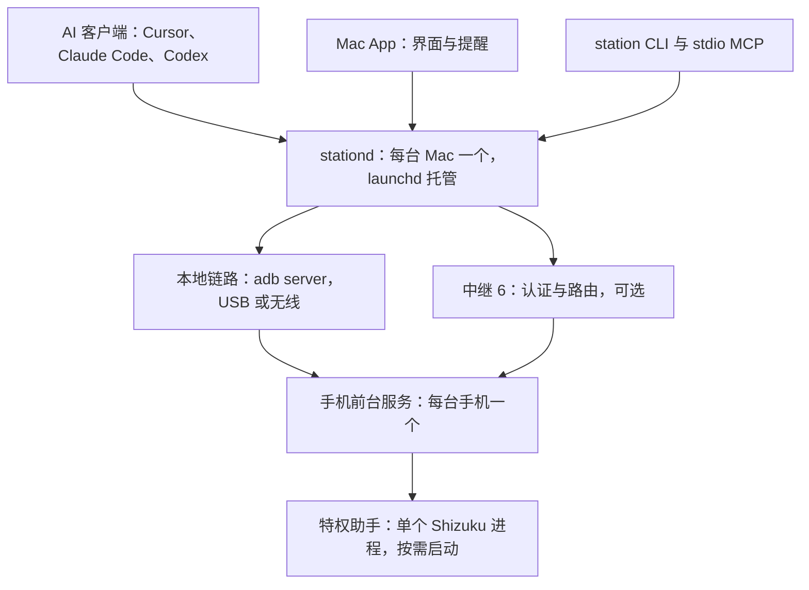

# 设计稿：架构改造路线

状态：实施中。正在运行的是 Android 72、Mac 0.1.0 (37)、中继 5。P0 计数器已部署。P1 已装到这两端，尚未完成：复制延迟有 63 ms（不确定度 16 ms）和 113 ms（不确定度 31 ms）；手机令牌无效时网关改走远程，约 5.5 秒后刷新转发并恢复本地；下午重新打开 USB 调试后菜单栏自己连上。晚上再关一次，序列号不再是 device 后 5/10/20/30 秒转发退避仍没跑。重新打开后菜单栏这次没有自己连上，手动 connect.sh 后本地已恢复，见[复核](history/validation.md#2026-10-16-序列号离开后退避不跑的复核)。序列号仍是 device 且本地 HTTP 探测失败时，5/10/20/30 秒都出现了，见[四档退避](history/validation.md#2026-10-17-本地-http-探测失败时的四档转发退避)。Mac 35 / Android 70 已通过的常驻助手 1 个、连续 shell、手电随助手退出、空闲不起进程和 Wi-Fi 短断，已在 Android 71 / Mac 37 上复采通过，见[复采](history/validation.md#2026-10-17-android-71--mac-37-复采常驻助手与-wi-fi-短断)。约 24 小时 `procstats` 不再挡住后续；14:52 按 `/proc` 重算主进程 12374 只跑了 1 小时 50 分，没有读，见[主进程年龄](history/validation.md#2026-10-17-主进程年龄未满-24-小时)和[不再等待运行时长](history/validation.md#2026-10-17-不再等待运行时长)。工具调用的 HTTP 401 和只丢包而 TCP 仍挂着记为这台机器上的限制，不再用同样的办法重试。这组已经复采通过。共用助手已装到 Android 72，见[共用助手](history/validation.md#2026-10-17-android-72-共用助手)。L4 这次没有开始，仍按切换与回滚，不和这次安装绑在一起。第二批审阅的 3 处已在运行版本里：僵死探测失败时，仍显示为 device 的会话不会被 connect.sh 断开，也不会在这条会话上复原；adb 把它标成 offline 后，原来的重连会换新端口，见[僵死无线 adb](history/validation.md#2026-10-16-僵死但仍显示为-device-的无线-adb)，本地挂起等待随路由启停并拉长重试，手机设备密钥在打开时生成且 StrongBox 失败回退普通 Keystore。P2 的 L0 向量、L1 链路库、L2 回执库和 L3 中继 6 已进入源码，未接入现有通道。特权助手的五个角色已装到 Android 72，未接入链路。L1b 的 Go 与 Java 引擎都在跑共用用例，接入前的会话结束、peer、心跳、原子入队、可写通知、收件上限和多会话复用已补进源码。L2 的结束时间、完整结果、单次定时器和损坏隔离也已补进源码。中继 6 的可信代理解析已在源码；正在运行的 phone-relay 是中继 5，不读这项配置。这些都还没接入现有通道。Mac 设备密钥自检走登录钥匙串里的软件密钥。手机设备密钥在 Android 70 上读过：StrongBox 为 false，签名第一次 22 ms，之后中位数 16.5 ms；诊断行未接入现有工具。手机上强杀后再查询回执还没有做。P3–P6 还没开始。现状部分依据 Android 72、Mac 0.1.0 (37)、中继 5，以及 2026-10-16 的[资源与耗电基线](history/validation.md#2026-10-16-资源与耗电基线)、[部署前后复测](history/validation.md#2026-10-16-p1-部署前后复测)和[三项复测](history/validation.md#2026-10-16-p1-三项复测)；当前行为仍以[架构](architecture.md)和各主文档为准。Mac 与手机之间的链路、设备身份、配对与授权在[统一链路与设备身份](link-v2.md)里详细设计，本篇只说明它在整体中的位置。某个阶段完成后，在[阶段](#阶段)表里更新状态，三端完成情况按[发布记录](releases.md)记录。

## 结论

1. **底子扎实。** 文件操作带版本号与原子写，远程操作有持久编号和回执，令牌不落明文，中继证书按 SPKI 固定，手机按授权项控制远程访问。这些保留，改造在其上进行。
2. **Mac 端的浪费在空闲轮询。** 本机 adb 没有连接手机时，App 仍每秒起一次 adb、每 5 秒运行一次 `mcp.sh status`，空闲约占 3% CPU。本地连接时，手机每秒执行 14 次 `settings get`、每 2 秒写一次系统设置，Mac 每分钟向手机发约 185 次请求（按代码推算）。改成推送后基本归零。
3. **手机端的浪费在特权进程和前台界面，不在后台服务。** 每个 Shizuku 助手进程约 60 MB PSS，采样时常驻 2 个（手电、剪贴板），每条 shell 命令再临时起 1 个；手电助手是被只读的状态查询拉起的。主进程只跑后台服务时平均 37 MB RSS，主页在前台时平均 172 MB、峰值 359 MB。耗电很低：16 小时约 35 mAh，占 0.75%。
4. **「一台 Mac 对一台手机」写死在四层。** 中继、网关、手机端的通知与剪贴板状态、本机脚本都只认一个对端。多设备要先换成按设备的身份和授权，再逐层放开。
5. **MCP 的主要问题是面向谁。** 51 个工具里混着 App 自己的同步和心跳接口，结果是文本里的 JSON，截图要三步才能让模型看到。MCP 2026-07-28 版规范取消了会话和 `initialize`，工位本来就不依赖会话，升级成本低。

## 已定前提

- 软件尚未正式发布，不保留旧协议和旧工具名，三端同批升级。
- 多设备只服务同一所有者的多台 Mac 与多台手机，不做多用户账户。
- 端到端加密可选，默认关闭，默认仍信任自建中继。
- 机型改为能力探测：通用功能直接可用，依赖机型的功能标为未验证，由用户在手机上按设备开启；实施时修改 AGENTS.md / CLAUDE.md 的机型规则。

## 现状：Mac 空闲时一直在做的事

以手机经 adb 在线、本地 MCP 开启、远程已配置为准。前四行和「网关远程调用」是首要改造对象。

| 来源 | 间隔 | 每次做什么 | 成本 | 改为 |
| --- | --- | --- | --- | --- |
| `LinkSession` 巡检 | 1 秒 | `adb devices -l`；手机在线时再经 `adb shell` 执行 14 次 `settings get` | Mac 每次起 2 个进程；手机每秒至少 15 个进程 | 设备增减用 App 已有的 track-devices 订阅；开关与状态由手机推送 |
| 旧的电脑心跳（`host-state.sh mark`，脚本已删除） | 2 秒 | zsh、adb 加 `settings put` 写时间戳 | 连接期间每天约 4.3 万次系统设置写入，并触发手机端观察者 | 心跳只记在手机内存 |
| `McpSession` 调 `mcp.sh status` | 5 秒，没有设备也运行 | zsh、python3、adb 和网关子命令；含经 `dumpsys` 读手机令牌 | Mac 每分钟几十到上百个进程 | 只在序列号变化或网关返回 401 时刷新 |
| 剪贴板会话 | 0.8 秒（本地） | `station_clipboard_exchange`；共享关闭时改为状态查询，频率不变 | 每分钟约 75 次请求；共享时手机经 Shizuku 读剪贴板 | 复用远程已在用的剪贴板变化监听（`ClipboardUserService.WATCH`），本地也只在变化时传输 |
| 通知会话 | 2 秒（本地） | `station_notification_poll` 或 `station_notification_status` | 每分钟 30 次请求 | 有新通知时推送（远程已有事件订阅，本地补上） |
| 设备健康 | 3 秒（远程 15 秒） | `station_device_status` | 每分钟 20 次请求 | 随状态推送 |
| 网关本地探测 | 1 秒 | 每次新建 `http.Client`；手机回 `Connection: close` | 每分钟 60 条经 adb 转发的新连接 | 常驻本地链路，靠链路心跳与 adb 设备事件判断存活 |
| 网关远程调用 | 每次调用；状态每 2 秒 | 每次起钥匙串助手读令牌、新建固定证书的 TLS，提交前先读一次状态 | 每次多 1 个进程、1 次握手、1 次往返 | 令牌与会话代号缓存在内存并复用连接，之后改走常驻链路 |
| 网关 `monitor` | 1 秒 | 重读并解析配置文件 | Mac 磁盘读取 | 按修改时间重读 |
| 手机各页面 | 1–2 秒（仅前台） | 整页重绘 | 主页前台亮屏时主进程约占 2.5% 单核（实测，含远程空闲流量） | 状态变化时重绘 |

间隔和「每次做什么」来自源码；Mac 起 adb 与 `mcp.sh` 的频率经本机采样核对；请求数和手机进程数按代码推算，是相关会话都在运行时的数值。手机侧进程、内存与耗电的实测见[基线](history/validation.md#2026-10-16-资源与耗电基线)。

## 现状：结构性问题

### 资源与效率

| 问题 | 依据 | 影响 |
| --- | --- | --- |
| 特权进程按功能叠加 | 剪贴板、终端、投屏、手电、shell 各一个 Shizuku UserService，实测每个约 60 MB PSS | 采样时常驻 2 个，每条 shell 命令再起 1 个 |
| 只读查询拉起特权进程 | `station_controls_status` 调 `ShizukuTorch.status`，绑定手电助手后不退出 | 一次状态查询多出约 60 MB 常驻内存 |
| shell 每条命令起新进程 | `ShizukuShell` 每次绑定、执行后移除 | 每条命令多一次 JVM 启动和约 60 MB 瞬时内存 |
| 两套状态来源 | Mac 一边经 adb 读 `phonestation_*` 系统设置，一边调 `station_controls_status`（已含功能开关），再在 `Station.phoneFeatures` 合并 | 重复轮询；两边不一致时还要调和 |
| 系统设置当通信通道 | 功能开关和 MCP 监听写在 Settings.Global（`StationFeatures.publish`、`publishListening`）。电脑心跳已经不写系统设置 | 功能开关仍会被其他应用读到 |
| 远程调用不复用连接 | `remoteCall` 每次读钥匙串、新建 Transport 并在结束时关闭，提交前先查一次状态 | 每次多一个进程、一次 TLS 握手和一次往返 |
| 三处串行 | 网关 `remoteGate`、中继 `device.active`、手机在控制连接的读循环里同步执行 | 传大文件时剪贴板和通知都要排队 |
| 二进制走十六进制 JSON | `remote_ops.py` 每 512 KiB 做一次 `chunk.hex()`，手机再解析一次 | 流量约翻倍；大块数据在手机堆上多次复制 |
| SwiftUI 全树失效 | `Station` 转发 15 个子会话的 `objectWillChange` | 任一计时器触发都让面板整体重算 |
| 安装包体积（次要） | APK 5.3 MB；两个 Go 程序解压后 7.5 MB 与 3.2 MB；dex 0.69 MB，未经 R8 | 下载与更新偏大 |

### 多设备

| 问题 | 依据 | 影响 |
| --- | --- | --- |
| 中继只服务一台手机 | 配置只有 `DeviceID`、`PhoneToken`、`DesktopToken`，默认 ID `pgt-an20`；`screenHub.current` 只有一个投屏会话 | 第二台手机或第二台 Mac 只能再部署一套中继 |
| 网关只有一份配置 | 只有一组 `RemoteURL`、`RemotePin`；本地固定 18766 转发 | 不能同时连两台手机 |
| 手机只认一台电脑 | `NotificationSyncState.client`、`ClipboardState.client` | 两台 Mac 会互抢通知游标和剪贴板版本 |
| 本机只接受一台在线手机 | `online_serial` 已按 `ro.serialno` 合并同一台手机的 USB 与无线连接，但发现两台不同的手机就失败 | 两台手机同时连着时脚本无法使用 |
| 远程权限不分电脑 | 手机按授权项控制远程（Android 64 起） | 不能给不同 Mac 不同权限，也不能单独撤销一台 |
| 机型写死 | Mac 端 `remote_ops.py`、`remote_terminal.py` 与手机端 `StationBridge`、`StayAwakeController` 都按 PGT-AN20 判断 | 第二台手机如果是其他型号，设备操作全部不可用 |

### MCP 接口

| 问题 | 依据 | 影响 |
| --- | --- | --- |
| 工具多且混着内部接口 | 51 个工具（文件类 20 个）；剪贴板交换、通知接收、投屏会话等 App 内部接口也在 `tools/list`；描述是较长的中文 | 模型更容易选错，工具描述占上下文 |
| 结果不结构化 | `toolOk` 把 JSON 序列化成一段文字 | 客户端无法按 schema 校验或直接展示 |
| 截图对模型不可见 | `station_screen_capture` 返回临时 PNG 路径，要再用文件工具下载、再调用 release | 看一张图要三步 |
| 协议版本停在 2025-03-26 | 2026-07-28 版是无状态的，有 `server/discover`、任务扩展和可缓存的列表 | 这些能力都用不上 |
| 作用域粒度粗 | [客户端令牌](mcp-clients.md)只分 status、files.read、files.write、shell | 不能单独授权剪贴板、截屏、安装 |
| 电脑与手机之间传文件不在 MCP 里 | 靠 `remote_ops.py` 分块上传 | AI 不能一步完成「把这个文件放到手机上」 |

### 安全与易用

| 问题 | 依据 | 影响 |
| --- | --- | --- |
| 中继能看到内容 | 没有端到端加密，[安全与授权](security.md)已说明 | 已定：做成可选，默认关闭 |
| 配对要手填 4 项 | HTTPS 地址、SPKI 指纹、两枚 64 位十六进制令牌（`RemoteRelayProfile`） | 门槛高、易填错 |
| 运行时依赖多 | zsh、python3、adb；本地投屏要 scrcpy；终端配对二维码要 node | 换一台 Mac 上手慢 |
| 管理界面挤在菜单栏面板 | 中继、客户端、权限和功能都在 360 pt 宽的弹出面板里 | 专业设置难找，也难承载多设备 |
| 守护进程自己拉起 | 网关用 `Setsid` 在后台运行，不受 launchd 管理 | 崩溃恢复、登录启动与升级替换各走各的 |

## 目标架构

每端只留一个常驻进程负责连接与状态，手机再加至多一个按需启动的特权助手；本地和远程用同一套链路协议，状态改为推送。

**Mac（每台）**

- stationd 由 launchd 托管，持有全部手机链路、MCP 服务、在途操作、通知与剪贴板中枢。
- 直接使用 adb server 协议（App 订阅设备变化已经这样做），不再起 adb、zsh、python3 子进程。
- App 只做界面：经本机套接字订阅一条状态流；管理类页面移到设置窗口。
- `station` CLI 与 stdio MCP 入口复用同一份 Go 代码，`scripts/` 保留为入口。

**中继（可选）**：同一所有者的设备注册表、邀请与在线状态推送；只做认证和路由，不保存操作与结果；每台手机一个投屏会话；开启端到端加密后只转发密文。见[中继 6](link-v2.md#中继-6)。

**手机（每台）**

- 一个前台服务承载链路、调度、回执与状态；状态变化主动推送，不再用系统设置当通信通道。
- 一个特权助手合并剪贴板、手电、shell、终端与投屏启动；状态查询不绑定它；剪贴板共享关闭且没有会话时退出。角色、退出，以及失败时灯和剪贴板怎么处理，见 [P2](#p2-link-v2-与单一特权助手)。
- 按「Mac × 授权项」授权；每台 Mac 各自订阅通知和剪贴板。

链路层的控制消息用 JSON，数据用二进制流；多个操作可以并发；心跳、能力协商和操作编号都在链路层；投屏走同一帧格式的独立媒体链路。细节见[统一链路与设备身份](link-v2.md)。

## 多手机与多 Mac

范围是同一所有者，不做多用户账户。

| 层 | 现在 | 改为 |
| --- | --- | --- |
| 身份 | 两枚共享的角色令牌，手工生成和填写 | 每台设备一把不可导出的设备密钥，deviceId 由公钥派生，见[设备身份](link-v2.md#设备身份) |
| 配对 | 手填中继地址、SPKI 指纹、手机令牌、电脑令牌 | 第一台 Mac 用加入码加入中继；之后由已加入的 Mac 发邀请，经本地 adb、拍照导入二维码或手输邀请码加入，手输时核对安全码，见[配对与授权](link-v2.md#配对与授权) |
| 中继 | 1 个设备 ID、1 对令牌、全局 1 个在途操作、1 个投屏会话 | 一个工位最多 32 台设备；只认证和路由；在途上限由手机声明；每台手机 1 个投屏会话 |
| 授权 | 手机按授权项控制远程，不区分电脑 | 手机按「Mac × 授权项」授权，可单独撤销一台；本地连接同样经过这张表 |
| 通知 | 手机只记 1 个接收方游标 | 每台 Mac 各自订阅、各自游标；提醒可选只发给当前在用的 Mac |
| 剪贴板 | 手机只记 1 个 client | 以手机为准的版本号并记录来源设备，避免两台 Mac 之间回环；合并规则在 P5 单独设计 |
| Mac 网关 | 1 份远程配置，固定 18766 转发 | 每台手机一条链路；本地转发按序列号分配；MCP 用 `device` 参数或 `/mcp/d/<id>` 路由 |
| 本机 adb | 只接受 1 台在线手机 | 多台手机并存，按设备分别建链；同一台的 USB 与无线连接仍按 `ro.serialno` 合并 |
| 机型 | 只在 PGT-AN20 开放设备操作 | 按能力探测；通用功能直接可用，依赖机型的功能（无线调试保持、手电、灯光跟随声音等）标为未验证，在手机上逐台开启 |
| 加密 | 中继可读内容 | 可选端到端加密，默认关闭，见[可选端到端加密](link-v2.md#可选端到端加密) |
| 界面 | 单设备视图 | 菜单栏显示当前手机并可切换；手机首页列出已授权的 Mac 和各自权限 |

## MCP v2

### 原则

1. stationd 是唯一的 MCP 服务端：AI 工具目录、作用域、设备路由都在 Mac 侧；手机只提供链路的[方法表](link-v2.md#方法与授权)，能力实现仍在手机应用服务里。
2. App 不再走 MCP：剪贴板同步、通知接收和投屏会话改用链路的方法与事件，`tools/list` 只留给 AI 用的工具。
3. 协议版本按客户端协商：兼容客户端在用的版本，同时实现 2026-07-28 版的 `server/discover`、请求自带协议版本和 `subscriptions/listen`；`tools/list` 带 `ttlMs` 并固定顺序。
4. 结构化输出：`outputSchema` 加 `structuredContent`，另附一段文字摘要；截图直接返回图片内容；大结果返回资源链接。
5. 长任务（安装、大文件、后台 shell）映射到任务扩展 `io.modelcontextprotocol/tasks`；任务编号就是链路的操作编号，状态以手机回执为准。
6. 作用域覆盖全部能力：在 status、files.read、files.write、shell 之外加 clipboard、capture、install、alert、control，并可限定到某台手机；外层仍以手机给这台 Mac 的授权为界。
7. 接入不用复制令牌：`station mcp` 作为 stdio 入口从钥匙串取凭据；App 一键写入 Cursor、Claude Code、Codex 的配置，并显示每个客户端最近的调用。
8. 工具名去掉 `station_` 前缀（客户端已按服务名分组），不保留旧名称；描述改为简短英文，界面仍用中文；改造前后各测一次 `tools/list` 的 token 数。

### 工具集

现有 51 个工具中，35 个合并为下表 18 个，16 个移出 `tools/list`。

| 工具 | 取代（省略 `station_` 前缀） | 说明 |
| --- | --- | --- |
| `device_list` | 新增 | 已配对的手机、在线状态、所走通道、机型与已验证能力 |
| `device_status` | `device_status`、`controls_status`、`storage_summary`、`file_access_policy` | 一次拿到电量、亮屏、功能开关、授权与阻塞项；不拉起任何助手进程 |
| `files_list` | `file_list`、`file_search` | 列目录或按名称搜索 |
| `files_stat` | `file_stat` | 返回 `targetVersion` |
| `files_read` | `file_read_text`、`file_read_bytes` | 文本或 base64，支持区间 |
| `files_write` | `file_write_text`、`file_write_bytes`、`file_append_text`、`file_append_bytes`、`file_truncate_bytes` | 覆盖已有文件必须带 `targetVersion` |
| `files_edit` | `file_replace_text`、`file_patch_bytes` | 精确替换或按偏移修补 |
| `files_manage` | `file_copy`、`file_move`、`file_delete`、`file_delete_directory`、`file_create_directory` | 用 `action` 区分；删除仍需版本 |
| `files_grep` | `file_search_text` | 按内容搜索 |
| `files_transfer` | 新增，由 stationd 执行 | Mac 路径与手机路径之间流式传输并校验 SHA-256；下载中断后按偏移续读，上传中断后整份重传 |
| `app_install` | 新增，取代脚本流程 | 从 Mac 路径安装 APK，作为长任务 |
| `screenshot` | `screen_capture`、`screen_capture_status`、`screen_capture_release` | 直接返回图片内容，自动释放临时文件 |
| `shell_run` | `shell_exec`、`shell_start`、`shell_status` | 短命令同步返回，长命令转为任务 |
| `clipboard_read`、`clipboard_write` | `clipboard_get`、`clipboard_set` | 显式读写；交换只留给 App |
| `phone_alert` | `notify` | 响铃、震动、横幅 |
| `device_control` | `stay_awake`、`torch`、`file_open` | 用 `action` 区分，各需对应授权 |
| `task_status` | `operation_status` | 按原编号查询；同时映射到 MCP 任务扩展 |

移出 `tools/list`、改为 App 经链路使用的接口：`clipboard_exchange`、`clipboard_configure`、`clipboard_state`，`notification_poll`、`notification_status`、`notification_configure`、`notification_icon`，`screen_open`、`screen_close`、`screen_status`、`screen_capture_start`，以及 `terminal_open`、`terminal_close`、`terminal_input`、`terminal_read`、`terminal_resize`。

## 阶段

不保留旧协议，每个阶段三端同批升级，按源码、测试、构建、设备部署、服务恢复分开报告。顺序：P1 的程序已在 Android 71 与 Mac 37，共用助手已装到 Android 72。约 24 小时 `procstats` 不挡阶段。L0–L3 已在源码。现版本上 70/35 那组已经复采通过，见[复采](history/validation.md#2026-10-17-android-71--mac-37-复采常驻助手与-wi-fi-短断)。L4 切换网关仍按切换与回滚，不和特权助手源码改动绑在同一轮；P3 可与 P2 后半段并行；P4 在 P2、P3 之后；P5 依赖 P2 到 P4；P6 的端到端加密在 P2 之后，其余可与 P3 到 P5 并行。

| 阶段 | 内容 | 规模 | 状态 |
| --- | --- | --- | --- |
| P0 | 基线与可观测 | S | 计数器已部署；Mac 两种在线状态已补测，峰值主要是主页前台的图形缓冲，见[部署前后复测](history/validation.md#2026-10-16-p1-部署前后复测)；运行计数布局已在真机点过；约 24 小时 `procstats` 不再挡阶段，进程没满就跳过，见[不再等待运行时长](history/validation.md#2026-10-17-不再等待运行时长) |
| P1 | 快速降耗 | M | Android 71 与 Mac 36 已安装（2026-10-16）。复制延迟 2 笔：63 ms 与 113 ms。USB 调试关掉后序列号离开列表，退避没有跑到；下午重新打开后菜单栏自己连上。晚上再关一次仍没跑到 5/10/20/30。重新打开后菜单栏这次没有自己连上，手动 connect.sh 后本地已恢复，见[复核](history/validation.md#2026-10-16-序列号离开后退避不跑的复核)。序列号仍在时，5 秒和 10 秒见过。2026-10-17 把服务 dump 拖过 2 秒后本地探测仍在。把 18766 转发指到没有服务的端口后，探测失败且序列号仍是 device，5/10/20/30 秒都出现了，见[四档退避](history/validation.md#2026-10-17-本地-http-探测失败时的四档转发退避)。工具调用的 HTTP 401 仍未覆盖。只丢包而 TCP 仍挂着也未覆盖：本机 sudo 要密码，手机 shell 改不了 tc。2026-10-17 换上 Mac 37。关掉再打开本地 MCP 后，序列号不变时菜单栏约 5.7 秒自己跑了 `mcp.sh status`，本地恢复，见[重新打开后的刷新](history/validation.md#2026-10-17-重新打开本地-mcp-后菜单栏自己刷新转发)。401 与只丢包记为限制。`procstats` 不挡阶段。14:52 主进程 12374 按 `/proc` 只跑了 1 小时 50 分，没有读。70/35 那组已在 71/37 复采通过，见[复采](history/validation.md#2026-10-17-android-71--mac-37-复采常驻助手与-wi-fi-短断) |
| P2 | Link v2 与单一特权助手 | L | L0–L3 已进源码，未接入通道；L1b 的 Go 与 Java 引擎已进源码并跑同一组用例，接入前待改已补进源码，未接入通道；L2 与 L3 的审阅项和 L2 的接入前待改已补进源码，手机上强杀后查询回执还没有做；可信代理解析已在源码，中继 5 的进程不读它；Mac 设备密钥已进源码，自检走登录钥匙串软件密钥，未接入通道；手机设备密钥诊断已进源码，打开时生成且 StrongBox 失败会回退；Android 70 上 StrongBox 为 false，签名第一次 22 ms，之后中位数 16.5 ms，未接入现有工具；隔离实例未启动；特权助手五个角色已装到 Android 72，终端和投屏不再单独起进程，未接入链路；荣耀相机 ACTION_IMAGE_CAPTURE 这次仍没做 |
| P3 | Mac 端整合为 stationd | L | 未开始 |
| P4 | MCP v2 | M | 未开始 |
| P5 | 多手机与多 Mac | L | 未开始 |
| P6 | 安全与专业化 | M–L | 未开始 |

### P0 基线与可观测

- 已完成：手机侧进程、内存、耗电与 CPU 的远程只读采样，以及本机 adb 没有连接手机时的 Mac 采样，见[基线](history/validation.md#2026-10-16-资源与耗电基线)。
- 已部署：内置计数器。手机「连接设置 → 运行计数」显示本次进程内的请求分类、成功的系统设置写入、助手进程的启动与退出、中继重连。剪贴板、shell 和手电从 P1 起共用一个进程，启动只计一次，记在拉起它的那一路；Android 72 上终端和投屏已并入同一个助手，不再另起进程，见[共用助手](history/validation.md#2026-10-17-android-72-共用助手)。这次没有重读运行计数的数字。`mcp.sh status --safe` 的 `usage.gateway` 是网关进程内的调用、钥匙串助手启动和链路恢复；`usage.app` 是菜单栏 App 本次进程的 adb、脚本和其他进程启动，以及每次启动 `connect.sh`。出现过手机到 Mac 的复制样本时，另有 `clipboardLatency`：样本数、最近一次毫秒、这次估计的不确定度和本次进程内的最大值，不含剪贴板内容。读计数不访问手机，数字也不进入状态推送。进程重启后内存计数清零；App 退出后文件里留下最后一次快照，看 `updatedAt`。
- 已补测：Mac「仅 adb」与「adb 与远程都在」的起进程数，以及主进程峰值主要来自主页前台的图形缓冲，见[部署前后复测](history/validation.md#2026-10-16-p1-部署前后复测)。运行计数的大字号、窄屏、中英和折叠重建已在 Android 71 上点过，见[运行计数布局](history/validation.md#2026-10-16-运行计数的大字号窄屏中英和折叠)。24 小时 `procstats` 还没到：2026-10-16 晚主进程当时只跑了约 7 小时 44 分；同日读令牌超时的观察结束后该进程已不在。2026-10-17 同版本再装后又换了主进程，计时再从头开始。13:07 的 `ps` 曾记成约 4 小时 52 分，和 14:18 的 1 小时 16 分对不上，两笔都没有沿用。14:52 按 `/proc` 重算，12374 从大约 13:02 起只跑了 1 小时 50 分，没有读 `procstats`。没有把短时数字当结论；70 的 0.89 GB 仍是短时峰值。见[尚未到期](history/validation.md#2026-10-16-android-71-的-24-小时-procstats-尚未到期)、[仍未满 24 小时](history/validation.md#2026-10-17-android-71-主进程仍未满-24-小时)和[主进程年龄](history/validation.md#2026-10-17-主进程年龄未满-24-小时)。2026-10-17 起这组读数不再挡住后续，进程没满约 24 小时就跳过，见[不再等待运行时长](history/validation.md#2026-10-17-不再等待运行时长)。

验收：补充的基线写入 `docs/history/`，作为之后每个阶段的对比口径。风险：只读采样，需要手机在线。源码里的计数器不能代替这次采样。

### P1 快速降耗

- 手机（已装到 Android 71）：状态查询不再为手电单独起进程；shell 不再每条命令起进程；前台页面不再按 1–2 秒整页重绘。实现时把原句收紧为下面这一条，因为「shell 放进常驻助手」和「空闲常驻不超过 1 个」不能再留下第二个 shell 或手电进程，而灯又绑在持有它的进程上。
  - 剪贴板、shell、手电共用一个 Shizuku 进程 `HelperUserService`。进程不在时，手电状态直接报告未开，不绑定；进程已在时，在这个进程里读真实状态。开灯才占住它；关灯后若没有其他持有者就退出，灯随进程关闭。
  - shell 复用这个进程。命令结束后，若剪贴板和灯都没持有，再留 30 秒给下一条命令，然后退出。有其他持有者时，命令结束就放开 shell 这一路，进程留给剪贴板或灯。
  - Android 71 上终端和投屏仍随会话单独起进程，会话结束退出，不算空闲常驻。Android 72 已把五个角色装进同一个 `:helper`，见[共用助手](history/validation.md#2026-10-17-android-72-共用助手)。
  - 助手启动计数按进程实际创建计一次，记在拉起它的那一路（剪贴板、命令或手电筒）。同一次进程上的后续调用不加。停止与这次启动成对。
  - 页面在连接、网络、系统设置、功能开关、中继阶段和 Shizuku 生死变化时重绘。电脑心跳、剪贴板 Mac 在线、通知 Mac 在线只在到期那一刻再画一次。运行计数展开时只更新那几行。
- Mac App（2026-10-16 换上 0.1.0 (36)；2026-10-17 换上 0.1.0 (37)）。实现时把原句收成下面几条：
  - 默认 TCP adb 不再每秒执行 `adb devices -l` 和 14 次 `settings get`。设备增减用已有的 track-devices。启动时仍查一次设备列表。非 TCP 的 adb 服务连不上这条订阅，仍按 1 秒复查列表，但不再读那 14 个设置。
  - 功能开关，以及本机 MCP、远程开关，改由 `station_controls_status` 返回。后两个是手机进程里已有的选择，不是 adb `settings get`。面板打开时沿用原来的控件状态查询；面板关闭不为了开关再查。
  - track-devices 仍会把已经僵死、但 adb server 还没摘掉的 TCP 会话列成在线。原先每秒的 shell 应答是在确认这条会话还活着。已补进源码：网关报告本地由在线变为离线、而 adb 列表里仍有这台设备时，App 做一次 `adb -s <serial> shell true`（2 秒超时），失败就按离线处理并走原来的重连；本机 MCP 关闭时没有网关探测，面板打开期间每 15 秒查一次，面板关闭不查。不恢复每秒轮询。探测失败后，网关本地重新在线时解除不可达标记并重新读设备列表；标记期间每 15 秒复查一次 `shell true`，不看面板和本机 MCP 开关，序列号离开列表或复查成功后停止。本机有「失败后由网关在线复原」和「失败后由复查复原」两条用例。Mac 36 已换上。2026-10-16 在 PGT-AN20 上看到：探测失败时会话仍是 device，`connect.sh` 没有断开它，同一条会话也没有复原；adb 随后把它标成 offline，原来的重连才换了新端口。同一条 TCP 在丢包后靠 15 秒复查或网关重新在线复原，这次没有覆盖。2026-10-17 本机 sudo 要密码，手机 shell 改不了 tc，仍未覆盖，见[只丢包](history/validation.md#2026-10-17-只丢包而-tcp-仍挂着仍未覆盖)。另外，`connect.sh` 只断开 adb 标为 offline 的无线条目，仍列为 device 的僵死会话不会被它断开，这种状态下「正在重新连接…」实际不会重连。P1 之前也是这样，这次不改。见[僵死无线 adb](history/validation.md#2026-10-16-僵死但仍显示为-device-的无线-adb)。
  - `mcp.sh status` 只在序列号变化，或工具调用收到 HTTP 401 时运行。状态流和 `snapshot` 仍在，它们不刷新 adb。同一次 401 后 5 秒内不重复刷新。序列号仍在、本机 MCP 开着、刷新后本地仍不在线时，按 5、10、20 秒再试，之后每 30 秒一次；本地恢复、序列号离开或本机 MCP 关掉就停。这是 USB 调试关闭再打开后、序列号还在但读令牌超时的补救。Mac 36 已换上。2026-10-16 复测时关掉 USB 调试会停掉 adbd，序列号离开列表，退避没有跑到，本地也没有恢复。用户重新打开 USB 调试后，菜单栏自己连上，本地与远程恢复。同日 23:48 再关一次：变成 offline 后没有 5/10/20/30 秒的 `mcp.sh status`，本地没有恢复。重新打开后菜单栏这次没有自己连上；手动 `connect.sh` 后本地恢复；00:36 远程已确认，重连次数从 10 变为 11。见[复核](history/validation.md#2026-10-16-序列号离开后退避不跑的复核)。同一天把手机本地令牌换成无效值：网关改走远程，约 5.5 秒后运行 `mcp.sh status`，转发和本地恢复；工具调用的调度器没有失败，所以没有走到 HTTP 401 分支。见[三项复测](history/validation.md#2026-10-16-p1-三项复测)。同日稍后，序列号仍列为 `device`、读令牌被拖过 2 秒时，看到大约 5 秒和大约 10 秒两次 `mcp.sh status`；20 秒和 30 秒这次窗口里没有出现。见[读令牌超时](history/validation.md#2026-10-16-序列号还在时读令牌超时的转发退避)。2026-10-17 把 18766 转发指到没有服务的端口，本地 HTTP 探测失败且序列号仍是 device，四档分别出现在大约 5.4、16.5、38.6 和 70.9 秒，见[四档退避](history/validation.md#2026-10-17-本地-http-探测失败时的四档转发退避)。工具调用的 HTTP 401 本轮仍没走到。2026-10-17 没有改令牌，还是没走到，见[401 未覆盖](history/validation.md#2026-10-16-工具调用的-http-401-仍未覆盖)和[仍未覆盖](history/validation.md#2026-10-17-工具调用的-http-401-仍未覆盖)。同一天换上 Mac 37 后，在 PGT-AN20 上关掉再打开本地 MCP：序列号不变、本地仍不在线时，菜单栏约 5.7 秒后自己跑了一次 `mcp.sh status`，本地随后恢复，转发保持 `tcp:18766` → `tcp:8765`。见[重新打开后的刷新](history/validation.md#2026-10-17-重新打开本地-mcp-后菜单栏自己刷新转发)。手机复制到写入 Mac 剪贴板的估计延迟记入 `usage.app` 的 `clipboardLatency`。Android 71 读到两笔：63 ms（不确定度 16 ms）和 113 ms（不确定度 31 ms）。
  - 本地剪贴板和通知共用一次挂起的 `station_event_wait`，不进入 `tools/list`。手机用已有的剪贴板 WATCH、通知监听，加上锁屏、监听连接和设置变化，把内存计数加一；请求最多等 25 秒。Mac 本机剪贴板仍约 0.8 秒看一次 changeCount，只有计数变了才向手机交换。等待生效后，空闲补查为 30 秒。手机返回 `unknown_tool` 时，Mac 停止等待并恢复原来的查询间隔。远程仍走已有事件流。这次等待不占 App 的单请求队列。未知工具现在回 JSON-RPC `-32001`，`data.code` 为 `unknown_tool`。Mac 按这个码停止等待，序列号或 `station_controls_status` 里的 `appVersion` 变化时重新尝试，不再看「没有这个工具」这句文案。Android 69 及以前回的是普通错误文案，Mac 当作暂时失败并重试；功能照常，只是多一路请求，所以部署先手机后 Mac。本地路由出现才挂起等待，走远程或没有路由时停掉，不再每秒空转。不是 `unknown_tool` 的连续失败从 2 秒加倍到最多 30 秒，成功后回到 2 秒。还没在旧版和新版手机之间复测。
  - `Station` 在面板关闭时不转发子会话；面板打开时只转发当前页会读到的会话。菜单栏图标仍由连接回调更新。连接页补了 `setup`，主页补了 `files`。静态检查还发现剪贴板页和远程权限页也读 `setup`，一并补上。`lib/check.py` 对照每页视图（含它嵌进去的子视图）里的 `station.<会话>` 读取与订阅表，缺了就失败。真机上每页仍要点一遍。
- 网关（已随 Mac 36 换上）：
  - `remote.json` 按路径、修改时间和大小缓存。本进程保存配置时更新缓存；其他进程改文件后，下一次读取看到新的修改时间或大小再解析。
  - 远程令牌按 revision 留在内存。未命中，或中继对这次桌面令牌返回 401 时，才启动钥匙串助手。命中不计入钥匙串进程。令牌不写入日志或状态输出。
  - 状态检查、远程调用、事件和投屏共用同一条按证书指纹固定的 TLS 连接。指纹变化才关闭空闲连接；单次调用结束不关。
  - 本地每秒探测复用同一个短超时 client。手机对每次应答仍发送 `Connection: close`，所以这条探测的 TCP 还是新的。常驻本地链路留到 P2。
- 心跳（已在 Android 71 与 Mac 36）。实现时把原句收成下面几条：
  - 手机把已认证的本地 MCP 请求记在内存的开机后时间上，6 秒内算本地在线。网关大约每秒的 `ping` 就是这次心跳，继续保留。不再写 `phonestation_host_ms` 或 `phonestation_host_transport`，也不再观察这两个键。旧值留在系统设置里也不算在线。
  - 本地已连接不再区分 USB 和无线，页面显示「本地」。Wi-Fi 断开或无线调试关闭不再立刻去掉这条心跳。USB 调试关掉仍马上算作本地未连接。远程仍看 `PhoneRelayClient` 是否已确认连接。
  - 本机 MCP 关闭时，网关的探测进不来，手机会显示电脑未连接，即使 adb 还在用。原先 adb 写入的心跳不依赖 MCP 开关。P1 接受这一点，在连接设置的说明里写明；P3 的链路心跳不依赖 MCP 开关，届时去掉这条限制。
  - 网关每秒一次的本地探测现在既是健康检查也是心跳，约每分钟 60 次请求，是 P1 之后本地空闲时的主要请求来源。复测时单独记录，P2 换成 20 秒的链路心跳。
  - 电脑心跳只记在手机内存里。`connect.sh` 不再在后台写心跳。`disconnect.sh` 只断开无线 adb。菜单栏 App 不再每 2 秒写心跳。空壳 `host-state.sh` 已删除，不再打进 Mac 包；[Mac App](mac-app.md) 与 [adb 保持](adb-keep.md) 不再把它当作现用脚本。`UsageCountersTest` 的样例路径改为 `connect.sh`。`docs/history/adb-keep.md` 仍保留当时 `host-state.sh watch` 正在写的记录。
  - MCP 读不到功能开关而 adb 在线时，在连上和每次打开面板时经 adb 读一次开关（一次 shell），不恢复每秒读取。MCP 能读到时仍用 `station_controls_status`。2026-10-16 关掉本地 MCP、远程仍开：手机和 Mac 都没有把按钮或说明写成「手机工位已暂停」，Mac 显示「运行中 · 远程」。这次远程仍能读到开关，没有走到 adb 投影。重新打开本地 MCP 后，菜单栏约 8 秒内没有自己刷新转发，手动 `mcp.sh status` 后本地恢复。见[本机 MCP 关闭](history/validation.md#2026-10-16-本机-mcp-关闭时的按钮和暂停文案)。源码已补上从关到开、序列号还在且本地仍不在线时刷新转发。2026-10-17 换上 Mac 37 后，在 PGT-AN20 上关掉再打开：菜单栏约 5.7 秒自己跑了 `mcp.sh status`，本地恢复，远程仍在，服务行没有写成暂停。见[重新打开本地 MCP](history/validation.md#2026-10-17-重新打开本地-mcp-时应刷新转发)和[重新打开后的刷新](history/validation.md#2026-10-17-重新打开本地-mcp-后菜单栏自己刷新转发)。

验收：`scripts/check.sh` 全量、`lib/android/build.sh`、`scripts/build-mac-app.sh`；按 P0 口径复测，手机常驻助手从 2 个降到最多 1 个，Mac 空闲起进程数与设置写入数接近零，手机复制后 Mac 出现内容的延迟不劣于现在。手机端源码已按上面的进程规则落地；空闲是否真的只剩 1 个、开灯与共享同时存在时灯是否还亮、连续 shell 是否不新起进程、去掉定时器后到期和权限变化是否仍会刷新，都要等部署到手机再看。Mac 端源码已按上面的轮询规则落地；空闲起进程、复制后的延迟、401 之后转发是否刷新，以及僵死 TCP 是否仍显示在线，都要等替换正在使用的 Mac App 并连上手机再看。网关缓存与连接复用、内存心跳是否在 6 秒内保持本地已连接，都要等新版装到手机并且换上新网关再看。Android 72 上终端或投屏会话不再另起 `:terminal` 或 `:screen`，见[共用助手](history/validation.md#2026-10-17-android-72-共用助手)。心跳不再写系统设置；功能开关仍在变化时写入。特权助手被系统杀掉后，剪贴板变化监听要等下一次剪贴板调用重新绑定，期间 Mac 回退到补查；部署后验证一次恢复时间；结束助手进程会关掉手电、打断剪贴板监听，要有对应授权才做。上面的 5 项已在源码里改完；第二批审阅的 3 处已随 Android 71 与 Mac 36 装上。部署后另做一次 Wi-Fi 短断：本地掉线、探测失败之后，网络恢复时 App 要自己回到已连接。部署到手机并换上正在使用的 Mac App 之前，不把 P1 写成完成。2026-10-16 部署 Android 70 与 Mac 35 后的结果见[部署前后复测](history/validation.md#2026-10-16-p1-部署前后复测)：常驻助手、连续 shell、手电随助手退出、Mac 空闲零起进程和 Wi-Fi 短断通过；USB 调试关闭再打开后的本地恢复、复制延迟、401 后的转发刷新没有通过或没有测到。Android 71 与 Mac 36 已安装。复制延迟有 63 ms 和 113 ms 两笔。USB 调试关掉后序列号离开列表，退避没有跑到；下午重新打开后菜单栏自己连上。晚上再关一次仍没跑到 5/10/20/30。重新打开后菜单栏这次没有自己连上，手动 connect.sh 后本地已恢复，见[复核](history/validation.md#2026-10-16-序列号离开后退避不跑的复核)。工具调用没有收到 HTTP 401；手机令牌无效时约 5 秒后由本地离线退避刷新转发。序列号仍在、读令牌超时只确认到大约 5 秒和 10 秒。2026-10-17 把服务 dump 拖过 2 秒后本地探测仍在。把 18766 转发指到没有服务的端口后，探测失败且序列号仍是 device，5/10/20/30 秒都出现了，见[读令牌超时](history/validation.md#2026-10-16-序列号还在时读令牌超时的转发退避)、[读令牌变慢](history/validation.md#2026-10-17-读令牌变慢时本地探测仍在)和[四档退避](history/validation.md#2026-10-17-本地-http-探测失败时的四档转发退避)。2026-10-17 换上 Mac 37。关掉再打开本地 MCP 后，菜单栏自己刷新转发，本地恢复。工具调用的 HTTP 401 和只丢包而 TCP 仍挂着记为这台机器上的限制，不再用同样的办法重试。约 24 小时 `procstats` 不再挡住后续。Mac 35 / Android 70 上通过的那组已在 71 / 37 上复采通过。见[不再等待运行时长](history/validation.md#2026-10-17-不再等待运行时长)、[复采](history/validation.md#2026-10-17-android-71--mac-37-复采常驻助手与-wi-fi-短断)、[三项复测](history/validation.md#2026-10-16-p1-三项复测)和[重新打开后的刷新](history/validation.md#2026-10-17-重新打开本地-mcp-后菜单栏自己刷新转发)。

风险：三端同批升级，不保留旧心跳与旧轮询。网关连接复用和本地挂起请求会在 P2 被链路取代，只做最小改动。

### P2 Link v2 与单一特权助手

- 按[统一链路与设备身份](link-v2.md#实施步骤)的 L0–L5 实施：统一帧格式、并发操作与手机回执、事件推送、设备密钥与配对、按 Mac 分项授权、中继 6。本地也走链路，不再用本地 HTTP 和手机临时令牌。首版方法与现有工具一一对应，MCP 工具面留到 P4。
- L0（已进源码，未接入现有通道）：帧、中继与本地认证签名、安全码和端到端加密的向量在 `lib/link/testdata/vectors.json`。Go `lib/link` 与 Java `dev.phonestation.adbkeep.link` 读同一份。加入、邀请和批准的原文也按原始字节相连，样本摘要由 Go `TestTranscriptBytes` 与 Java `LinkVectorTest` 固定。中继 6 的测试服务器使用帧和这些原文；MCP、网关和中继 5 仍不使用。实现时把原先没写死的字节补进设计：认证与安全码按原始字节直接相连；HKDF 的盐、信息串、方向常数和去掉 peer 的 16 字节附加数据按[加密](link-v2.md#可选端到端加密)一节。测试密钥的私钥标量是 1 到 5，不能当作设备密钥。
- L1（已进源码，未接入现有通道）：同一对 Go 与 Java 库做分片重组（上限 1 MiB）、每条流 128 KiB 初始窗口、最多 8 条流、四级发送优先级、20 秒发送心跳和 45 秒无入站帧断开，并拒绝超限与畸形帧。中继 6 的测试服务器调用帧编解码。网关、中继 5 和手机服务仍不调用分片、窗口、优先级和链路引擎。L1b 的 Go 引擎在 `lib/link` 的 `Endpoint`，Java 引擎在 `LinkEngine`，读写的都是帧。共用用例在 `lib/link/testdata/engine.json`，覆盖乱序、交错分片、超窗、重置和慢接收方；两种语言都通过，见[流](link-v2.md#流)。接入前的几条已在源码里，并各有一条共用用例：序号不连续结束会话，拉出时写入 peer，心跳在链路层且正文是 JSON，整条消息原子入队，可写通知，收件上限，多会话按优先级复用。见[实施步骤](link-v2.md#实施步骤)的 L1 行。仍未接入通道。
- L2（已进源码，未接入现有工具）：回执和三个执行队列在 `LinkReceipts`。有副作用的方法先把 `queued`、再把 `running` fsync 到磁盘，然后才执行。同编号同摘要返回原回执；摘要不同返回 `conflict` 且不覆盖、不执行。只读方法不落盘。每个 Mac 最多 8 个在途；特权队列在进程内最多 4 个排队，超过 10 秒改为 `expired`。再次打开同一目录时，`queued` 变为 `expired`，`running` 变为 `unknown`，`receiptEpoch` 不变。磁盘格式、只读初表和队列划分见[手机端规则](link-v2.md#手机端规则)。`OperationJobs` 仍是现有终端和安装的回执，没有调用这个库。审阅项已补进源码，并在本机临时目录上各有一条用例：超长结果记 `complete`，这次查询仍返回完整正文，磁盘不存，`resultKept` 为 false；`LinkReceipts.NotApplied` 记 `applied: false`，其他异常记 `applied: true`；改名后同步目录，电脑测试注入 `DirectorySync`；`queued` 写失败返回 `busy` 且不留文件，`running` 写失败记 `expired` 并释放名额，最终状态写失败时本进程按内存结果应答、重启后变为 `unknown`；上限 4096 条、正文合计 8 MiB，提交和查询走内存索引；只读调用占在途名额；特权排队超过 10 秒由定时器过期，不等前一个操作结束。接入前的四条已在源码里，并各有一条用例：结束时把完整结果留在内存，年龄从结束时算起，单次定时器取代 200 毫秒扫描，隔离损坏的回执并清理临时文件。见[实施步骤](link-v2.md#实施步骤)的 L2 行。手机上强杀进程后再查询还没有做，不把 L2 写成完成。
- L3（已进源码，未接入现有通道）：中继 6 在 `server/relay/internal/v6`。它只提供 `GET /v2/link`，做注册表、一次性加入码、邀请、按 purpose 路由和在线推送，不保存操作正文。真实 TLS 测试在这个模块的 `go test` 里，`scripts/check.sh` 跑中继模块时会带上。`cmd/phone-relay` 仍是中继 5，发布包也仍是中继 5。`phone-relay enroll` 留到切换部署。隔离实例还没启动。字节、限流和错误码见[中继 6](link-v2.md#中继-6)。审阅项已补进源码，本机测试通过：认证先验签，`unknown_device`、`revoked` 和 `bad_signature` 不计数；每条链路一个写协程，主链路待发队列 4 MiB、媒体链路 8 MiB；写盘失败只拒绝这一次改动，已注册设备仍能认证，磁盘恢复后的下一次写入会再试；名称拒绝 Cf。同地址撤销设备不影响其他设备、慢接收方不阻塞发送方、写盘失败后已注册设备仍能认证，这三条都有用例。可信代理默认关闭。`ParseTrustedProxies` 解析逗号分隔的 IP，环境变量名预定为 `PHONE_RELAY_TRUSTED_PROXIES`。`phone-relay` 是中继 5，不读这个变量。部署中继 6 时由那个进程接上。未接入现有通道，也不启动隔离实例。
- Mac 设备密钥（已进源码，未接入现有通道）：`DeviceKey` 先试 Secure Enclave P-256，失败再用登录钥匙串里的软件密钥。2026-10-16 本机自检，临时签名程序和 `codesign --sign -` 的临时 App 都因缺少 entitlement 得到 -34018，软件密钥完成签名与校验，测试密钥已删除，没有系统授权弹窗。正在使用的 App 没有替换。软件密钥按当前用户放行，同一用户的其他进程也能用它签名，比现在的中继令牌弱；P6 改用 Developer ID 签名后换成 Secure Enclave。见[实施前要核实](link-v2.md#实施前要核实)。
- 手机设备密钥（已进源码，未接入现有工具）：`PhoneDeviceKey` 在 Android Keystore 生成 P-256，优先 StrongBox，后台签名不要求用户验证。受 DUMP 保护的服务 dump 增加一行 `deviceKey strongBox=… signMs=…`，不写密钥或签名。别名 `phone-station-device-p256` 不存在时，打开密钥时创建它，生成时间不算进 `signMs`。StrongBox 生成失败回退普通 Keystore。生成器可注入；本机测了诊断行、输出不含密钥，以及 StrongBox 生成失败时回退。2026-10-16 在 Android 70 / PGT-AN20 上读到 StrongBox 为 false，签名第一次 22 ms，之后四次中位数 16.5 ms。未接入现有工具。API 31 以下已有密钥会把 StrongBox 记成 false。
- 终端和投屏并入 P1 已经合并的剪贴板、shell、手电进程（2026-10-17 已装到 Android 72，没有接入 Link v2，现有 MCP 工具名不变。安装前 `scripts/check.sh` 已通过，见[共用助手](history/validation.md#2026-10-17-android-72-共用助手)）。五个角色共用一个非 daemon 进程，标签 `station-helper`，进程名后缀 `helper`，入口是 `HelperUserService`。调用仍用原来的接口名，分给原来的剪贴板、shell、手电、终端和投屏实现。不再绑定 `station-terminal` 和 `station-screen`。助手的 Shizuku 版本是 71，包版本是 72；装上后进程已换。
  - 角色与启动。剪贴板在共享打开并绑上监听时持有。shell 在执行命令时持有。手电在开灯时持有；进程不在时，只查询直接报告未开，不绑定。终端在要创建会话时持有。投屏在打开会话时持有。第一路持有才绑定进程，启动计数记在这一路。进程已经在时，后来的角色只加上持有，不再计一次启动。
  - 退出。最后一路放开才解除绑定，进程退出。shell 若是唯一持有者，命令结束后仍留 30 秒。关掉剪贴板共享只放开剪贴板；灯、未到期的 shell、终端会话或投屏还在，进程就留着。终端会话进入 `closed`、`exited`、`expired` 或 `lost`，并且没有别的终端会话时，停掉进程里的 PTY 并放开终端。投屏收到本会话的 `close`，或本会话状态成为 `ended` 时，停掉采集并放开投屏。对另一个投屏编号返回 `lost` 时，不放开仍在进行的会话。
  - 失败时的灯和剪贴板。整个助手进程退出、崩溃或被系统杀掉时，相机闪光灯随进程释放，灯灭；剪贴板监听一起没了，下一次剪贴板调用重新绑定。终端和投屏会话记为结束，不自动重建。终端或投屏自己的操作在进程还活着时失败，只停该角色的子进程，不退出助手。灯的持有还在，灯就继续亮；剪贴板的持有还在，监听就继续留着。绑定失败只撤回正在申请的那一路。进程没起来时没有东西要停，已经亮着的灯和已经绑上的剪贴板不动。
- 文件、APK 与截图走二进制流，手机侧用固定大小的缓冲。

验收：链路设计各步骤的本机与真机验收；链路合约测试接入 `scripts/check.sh` 的真实 TLS 联合合约；配对全程不出现明文令牌。本地与远程各做一次 APK 安装和大文件往返；手电持灯、终端会话和投屏在单一助手下各验证一次（设备操作要有对应授权）。终端和投屏已在 Android 72 的同一个助手上验过：没有单独的 `:terminal` 或 `:screen`，关掉后会话不留。手电这次保持关闭，没有为了持灯再开。剪贴板共享开着时，关掉终端和投屏没有把整个助手打退出去；没有另造失败。荣耀相机 `ACTION_IMAGE_CAPTURE` 这次仍没做。L4 没有开始。链路本身还没接入。

风险：直接替换 control-v1 与本地 HTTP，不保留双栈。按[切换与回滚](link-v2.md#切换与回滚)执行；公网切换前按 AGENTS.md 准备版本、影响、验证与回滚条件，并先排空在途操作。

### P3 Mac 端整合为 stationd

- 网关升级为 stationd：用 SMAppService 注册 LaunchAgent，取代 `Setsid` 自启动；直接使用 adb server 协议（track、forward、shell v2）；mDNS 发现移入 Go。
- App 与 stationd 之间用本机 Unix 套接字，校验对端 UID 与代码签名；一条状态流加命令；去掉状态 watch 子进程。
- `station` CLI 承接 `scripts/` 的实现，`scripts/*.sh` 保留为入口；运行时不再依赖 python3 与 node，开发和测试照用。
- 本地投屏与录屏改走远程投屏已有的原生解码管线，scrcpy 变为可选。

验收：`scripts/check.sh`；用假 adb server 的 stationd 集成测试；Mac 包构建；登录启动、崩溃自启、升级替换；按 P0 口径复测。

风险：迁移时要清理旧守护进程残留与端口占用。AGENTS.md / CLAUDE.md 里关于 `lib/adb_mdns.py`、`online_serial` 和脚本写法的规则随之改写，经 agent-docs-sync 同步。

### P4 MCP v2

- 按上文[MCP v2](#mcp-v2)的原则与工具集实施；App 内部接口全部移出 `tools/list`；同步更新 phone-mcp Skill、脚本、文档，以及 AGENTS.md / CLAUDE.md 中引用的工具名。

验收：Cursor、Claude Code、Codex 各接入一次并跑典型任务；`tools/list` 的 token 数前后对比。

风险：直接改名，不保留旧工具名；已有客户端配置由 App 一键更新。

### P5 多手机与多 Mac

- 设备身份、配对、按 Mac 授权和多设备中继在 P2 已经具备。本阶段放开其余各层：每台 Mac 的通知订阅与提醒去向、多台 Mac 的剪贴板合并规则（单独设计）、本机多台手机并存、stationd 按设备路由、菜单栏切换手机。
- 去掉两端写死的 PGT-AN20 判断，改用 P2 方法表里的已验证标记；经 agent-docs-sync 修改 AGENTS.md / CLAUDE.md 中「只在 PGT-AN20 验证」「唯一在线设备」等规则，并更新架构与 MCP 文档。

验收：2 台 Mac × 2 台手机的矩阵：通知各自送达、剪贴板不回环、单独撤销一台 Mac、投屏互不干扰。依赖机型的功能只在 PGT-AN20 上判定通过，其他机型显示为未验证并默认关闭。

风险：需要第二台手机，是其他型号时只验证通用功能。中继切换同 P2 的公网规则。

### P6 安全与专业化

- 可选端到端加密，即链路设计的 L6，默认关闭；开启后中继只见元数据。
- Developer ID 签名、公证与自动更新；签名后 Mac 设备密钥换成 Secure Enclave，按新设备重新加入。两端脱敏诊断包与日志轮转。
- Mac 设置窗口承载设备、客户端、中继与权限；菜单栏面板只留快捷操作。
- 手机「分享到 Mac」、Mac 拖放到手机，复用二进制流。

验收：开启加密后中继侧只见密文；统计新 Mac 从安装到可用的步骤数。

风险：签名与公证需要 Apple 开发者账号。

## 资源目标

| 指标 | 现在 | 目标 | 主要手段 |
| --- | --- | --- | --- |
| Mac 周期性起进程 | 手机未连 adb 时约每秒 1 次（实测）；在线时更多（推算） | 0 | 事件驱动；stationd 直连 adb server |
| Mac App 空闲 CPU | 约 3%（手机未连 adb，实测） | 接近 0 | 同上；面板关闭时不重算视图 |
| Mac 常驻进程与内存 | App 33 MB、网关 13 MB、状态 watch 5 MB（实测） | App 不高于现在，stationd 不超过 20 MB，去掉 watch 进程 | 合并进程 |
| 本地空闲请求 | 约 185 次/分钟（推算） | 每 20 秒一次链路心跳，其余有变化才推送 | 链路推送 |
| 手机空闲进程创建（本地连接） | 每秒至少 15 个（推算） | 0 | 不再用 adb shell 读状态 |
| 系统设置写入 | 连接期间每 2 秒 1 次 | 只在开关真正变化时 | 心跳只记内存 |
| 手机特权进程 | 常驻 2 个，每条 shell 命令再起 1 个，各约 60 MB PSS（实测） | 最多 1 个；剪贴板共享关闭且没有会话时退出 | 状态查询不绑定；合并 UserService |
| 手机主进程（后台） | 平均 37 MB RSS（24 小时统计） | 保持在 40 MB 以内 | — |
| 手机主进程（主页前台） | 平均 172 MB RSS、峰值 359 MB；亮屏约 2.5% 单核（实测） | 先查明峰值来源；只在状态变化时重绘 | 事件驱动界面 |
| 手机耗电 | 16 小时约 35 mAh，占 0.75%（实测） | 不升高 | 推送替代轮询 |
| 远程单次调用 | 1 个进程、1 次 TLS 握手、2 次往返 | 1 次往返 | 常驻链路 |
| 大文件流量 | 十六进制后约 2 倍 | 约 1 倍，固定小缓冲 | 二进制流 |

「实测」来自本机采样与手机远程只读采样，「推算」来自源码。每个阶段完成后按基线的同样方法复测。

## 未核实与边界

- Mac「仅 adb」与「adb 与远程都在」的空闲起进程已在 Mac 34 / Android 70 上采过，见[部署前后复测](history/validation.md#2026-10-16-p1-部署前后复测)。复制延迟在 Android 71 / Mac 36 上有 63 ms 和 113 ms 两笔。工具调用的 HTTP 401 还没走到。2026-10-17 没有改令牌，仍未覆盖，见[401 未覆盖](history/validation.md#2026-10-16-工具调用的-http-401-仍未覆盖)和[仍未覆盖](history/validation.md#2026-10-17-工具调用的-http-401-仍未覆盖)。这项记为限制，不再用同样的办法重试，见[不再等待运行时长](history/validation.md#2026-10-17-不再等待运行时长)。网关随 Mac 37 换上。
- 手机上的本地已连接改为 6 秒内的已认证 MCP 请求，不再区分 USB 和无线。USB 调试关掉后序列号会离开列表，本地不恢复；下午重新打开后菜单栏自己连上。见[三项复测](history/validation.md#2026-10-16-p1-三项复测)。晚上再关一次，5/10/20/30 秒转发退避仍没跑。重新打开后菜单栏这次没有自己连上，手动 connect.sh 后本地已恢复，见[复核](history/validation.md#2026-10-16-序列号离开后退避不跑的复核)。序列号仍在、读令牌超过 2 秒时，只看到大约 5 秒和大约 10 秒两次刷新。2026-10-17 再把服务 dump 拖过 2 秒，本地探测仍在。把 18766 转发指到没有服务的端口后，探测失败且序列号仍是 device，5/10/20/30 秒都出现了。见[读令牌超时](history/validation.md#2026-10-16-序列号还在时读令牌超时的转发退避)、[读令牌变慢](history/validation.md#2026-10-17-读令牌变慢时本地探测仍在)和[四档退避](history/validation.md#2026-10-17-本地-http-探测失败时的四档转发退避)。
- 仍显示为 device 的僵死 TCP：2026-10-16 探测失败后同一条会话没有复原，`connect.sh` 没有断开它。adb 把它标成 offline 之后，原来的重连换了新端口。同一条 TCP 靠 15 秒复查或网关重新在线复原，这次没有覆盖。2026-10-17 本机 sudo 要密码，手机 shell 改不了 tc，仍未覆盖。这项记为限制，不再用同样的办法重试。见[僵死无线 adb](history/validation.md#2026-10-16-僵死但仍显示为-device-的无线-adb)、[只丢包](history/validation.md#2026-10-17-只丢包而-tcp-仍挂着仍未覆盖)和[不再等待运行时长](history/validation.md#2026-10-17-不再等待运行时长)。
- 第一批和第二批源码审阅当时只读了代码并跑了本机检查，没有连接手机。随后 Android 71 与 Mac 36 已换上，中继仍是 5。页面订阅表现在由 `lib/check.py` 对照视图里的 `station.<会话>` 读取；经子视图 `@ObservedObject` 传入、不再写 `station.<会话>` 的会话不在这条检查里。真机上每页仍要点一遍。
- 手机数值原来是在主页前台、充电、远程空闲时采到的。2026-10-16 补了息屏和蜂窝各一次，见[息屏与蜂窝](history/validation.md#2026-10-16-息屏与蜂窝)。长时间后台和 24 小时 `procstats` 仍没有单独结论。2026-10-17 13:07 的 `ps` 曾记成约 4 小时 52 分，没有读 `procstats`，见[仍未满 24 小时](history/validation.md#2026-10-17-android-71-主进程仍未满-24-小时)。14:52 按 `/proc` 重算只跑了 1 小时 50 分，仍跳过，见[主进程年龄](history/validation.md#2026-10-17-主进程年龄未满-24-小时)。这组读数不再挡住后续，见[不再等待运行时长](history/validation.md#2026-10-17-不再等待运行时长)。
- 每个助手约 57 MB 私有匿名内存。Android 70 的 showmap：助手私有脏页约 56 MB，其中 Dalvik 匿名内存 44 MB；它由 app_process 单独启动，拿不到 zygote 共享。
- 主进程峰值主要来自主页前台的全屏图形缓冲，见[部署前后复测](history/validation.md#2026-10-16-p1-部署前后复测)。70 的 `procstats` 前台峰值 0.89 GB 是短时数字，不能当结论。
- MCP 2026-07-28 版规范的细节，以及 Cursor、Claude Code、Codex 实际支持到哪一版，在 P4 开始前按规范原文和客户端版本核对。
- 链路设计自身的核实项见[实施前要核实](link-v2.md#实施前要核实)。Mac 设备密钥已在 `DeviceKey`，未接入现有通道。2026-10-16 自检：临时签名进程和临时 App 创建 Secure Enclave 密钥都得到 -34018，回退登录钥匙串里的软件 P-256，签名与校验成功，测试密钥已删除，没有系统授权弹窗。正在使用的 App 没有替换。软件密钥按当前用户放行，同一用户的其他进程也能用。手机设备密钥的诊断行已在受 DUMP 保护的服务 dump 里。打开时生成，StrongBox 失败回退普通 Keystore，`signMs` 只量签名。Android 70 / PGT-AN20 上 StrongBox 为 false，签名第一次 22 ms，之后中位数 16.5 ms。
- 中继 6 的限流、待发队列、写失败和名称检查已在源码里，并用本机临时目录上的真实 TLS 测过，包括同地址撤销、慢接收方和写失败后仍能认证。隔离实例还没启动，也没有部署。正在运行的中继仍是 5。未接入现有通道之前不启动隔离实例。
- L2 回执的补齐项已在本机临时目录上有对应用例：超长结果、未执行失败、目录同步替身、三种写失败、4096 条与内存索引、只读占在途、定时过期。手机上强杀进程后再查询还没有做。接入前的四条已在本机临时目录上有用例：结束时保留完整结果、年龄从结束时算、单次定时器、损坏回执隔离。目录 fsync 在电脑上只验证替身被调用；`android.system.Os` 打开目录只有在手机上跑才算验证过。
- 第二台手机要拿到设备后才能验证；非 PGT-AN20 机型上依赖机型的功能保持未验证。
